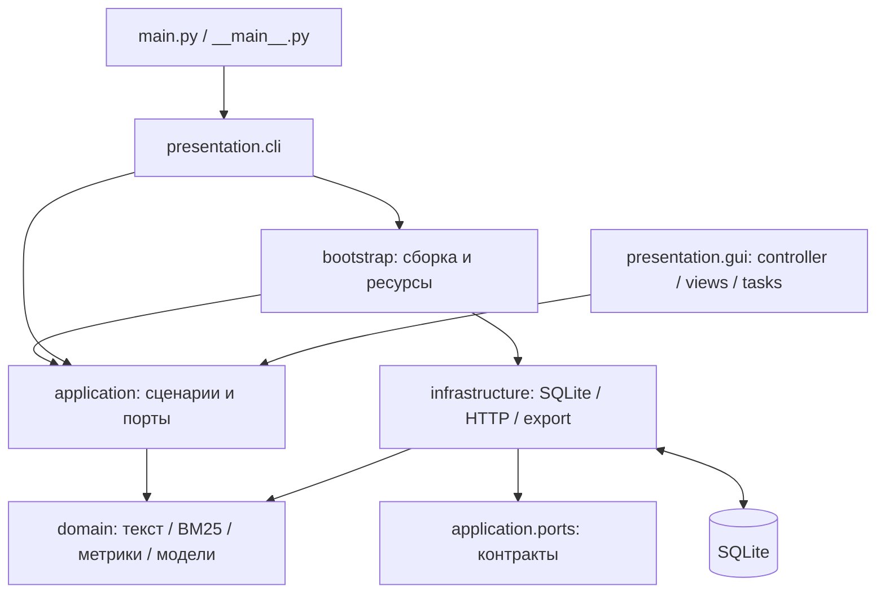

# Лабораторная работа № 1 — вариант 36

**Тема:** разработка информационно-поисковой системы и оценка качества её работы.

Требования взяты из файла `Лабораторная работа 1 (1).pdf`, страницы 5–7.
Вариант 36: **модуль отбора документов; сеть Интернет; вероятностная стратегия поиска; английский язык**.
Английский относится к языку документов и запросов; интерфейс и документация — на русском.

Система загружает заданные интернет-страницы, сохраняет их текст и индекс в SQLite,
ранжирует документы по BM25, показывает исходные ссылки и совпавшие слова запроса.
Отдельное подменю рассчитывает качество по экспертным оценкам и показывает таблицы и графики.

## Быстрый запуск в PyCharm

Нужен **Python 3.10 или новее** с Tkinter. Разработка и проверка выполнены на Python 3.12.6 / Windows.
Для графиков требуется Matplotlib: зависимости перечислены в `requirements.txt`.
`pypdf` использовался только для чтения PDF во время разработки и не нужен для запуска.

В терминале PyCharm из папки проекта:

```powershell
python -m pip install -r requirements.txt
python main.py
```

Либо откройте `main.py` и выберите **Run 'main'**. Рабочую папку в Run Configuration
удобно установить в корень проекта; путь к базе по умолчанию всё равно вычисляется относительно `main.py`.
При первом запуске автоматически создаётся `data/search.sqlite3`.

Для демонстрации:

1. Вкладка **«Коллекция»** → **«Загрузить демо»**. Добавятся 12 документов и оценки для пяти запросов.
2. Вкладка **«Поиск»** → введите `python programming` → **«Найти»**.
3. Выберите результат, чтобы увидеть фрагмент текста. Двойной щелчок или **«Открыть ссылку»** открывает сайт.
4. **«Текст и ключевые слова»** показывает сохранённый текст, дату добавления и веса терминов.
5. Вкладка **«Оценка качества»** → **«Оценить все»**. Откройте подстраницы «Результаты» и «Графики», выберите данные и тип диаграммы.
6. **«Экспорт отчёта»** → выберите папку. Создадутся HTML, CSV, JSON, SVG и PNG.

Готовый воспроизводимый отчёт: [reports/demo/report.html](reports/demo/report.html).
Его можно открыть в браузере без запуска программы. SVG, PNG и таблицы находятся рядом.

## Загрузка документов из Интернета

На вкладке «Коллекция» укажите URL одной англоязычной страницы, например:

```text
https://docs.python.org/3/tutorial/
https://docs.python.org/3/library/sqlite3.html
https://www.sqlite.org/lang.html
```

Нажмите «Загрузить». HTTP(S)-загрузчик получает HTML, извлекает заголовок и видимый текст,
удаляет содержимое `script`, `style`, `head` и других служебных элементов.
HTML-сущности вроде `&amp;` преобразуются в символы. Поддерживается также `text/plain`.
Редирект учитывается: сохраняется конечный URL без фрагмента `#anchor`.
Ожидание сетевых операций ограничено таймаутом 15 секунд; размер ответа — 2 MiB.
Таймаут относится к сетевым операциям, а не к гарантированной общей длительности загрузки.

Загрузка идёт в отдельном потоке, поэтому окно остаётся доступным.
Поток передаёт результат через очередь; обновление Tkinter и запись в SQLite выполняются в основном потоке.
Ошибка сети, неподдерживаемый формат или отсутствие английских терминов отображаются пользователю.

Повторная загрузка того же URL обновляет документ. Если текст изменился,
индекс перестраивается и прежние оценки этого документа удаляются: их нужно выставить заново.
Для неизменённого текста оценки сохраняются. Удаление документа каскадно удаляет его индекс и оценки.

Это поиск по **локально сохранённой коллекции интернет-документов**, а не запрос к глобальной поисковой службе.
Рекурсивный обход сайтов, выполнение JavaScript, страницы с авторизацией и PDF-импорт не реализованы.
Исходный PDF — задание, а не формат входной поисковой коллекции.

## Архитектура и взаимодействие компонентов

Система устроена как модульный монолит со слоями предметной логики, прикладных
сценариев, инфраструктуры и представления. Подробное проектирование, проведённое
до рефакторинга, записано в [docs/ARCHITECTURE.md](docs/ARCHITECTURE.md).

`domain` содержит типизированные неизменяемые модели и чистые расчёты; он не знает
о SQLite, HTTP и Tkinter. `application` координирует сценарии и транзакции через
небольшие `Protocol`-контракты. `infrastructure` реализует хранение, загрузку и экспорт.
CLI и GUI используют одни и те же сервисы. Зависимости явно передаются через конструкторы.
`bootstrap.py` собирает компоненты и закрывает соединение с базой через context manager.
`main.py` только делегирует запуск CLI-адаптеру, который по умолчанию открывает GUI.



| Файл | Ответственность |
| --- | --- |
| `main.py`, `ir_system/__main__.py` | Точки запуска без прикладной логики |
| `ir_system/config.py`, `bootstrap.py` | Конфигурация, внедрение зависимостей, жизненный цикл ресурсов |
| `ir_system/domain/` | Модели, нормализация, BM25, TF-IDF, метрики, смысловые ошибки |
| `ir_system/application/ports.py` | Контракты чтения/записи, транзакций, загрузки, источника и экспорта |
| `ir_system/application/services.py` | Коллекция, поиск, разметка, оценка и экспорт: общие сценарии GUI/CLI |
| `ir_system/infrastructure/sqlite.py` | SQL, версия схемы, транзакции и снимок корпуса |
| `ir_system/infrastructure/web.py`, `fixtures.py` | Адаптеры HTTP и учебной JSON-коллекции |
| `ir_system/infrastructure/reporting/` | Экспорт HTML/CSV/JSON/SVG/PNG |
| `ir_system/reporting.py` | Общие имена и пояснения метрик |
| `ir_system/visualization.py` | Общие построители Matplotlib Figure для GUI и экспорта |
| `ir_system/presentation/cli.py`, `commands.py` | Аргументы, отдельные команды, вывод и коды завершения |
| `ir_system/presentation/gui/` | Пассивные вкладки, контроллер, виджеты, фоновые задачи и справка |
| `fixtures/collection.json` | Тексты, ссылки, информационные потребности и эталонная разметка |
| `tests/test_*.py` | Проверки предметной логики, сценариев, адаптеров, CLI, архитектуры и фоновых задач |
| `tests/gui_smoke.py` | Отдельная проверка реального Tkinter-интерфейса |
| `reports/demo/` | Сохранённые результаты оценки учебной коллекции |

### Структура базы данных

| Таблица | Поля | Назначение |
| --- | --- | --- |
| `documents` | `id`, `url UNIQUE`, `title`, `text`, `added_at`, `length` | Исходный документ, время загрузки UTC, длина после нормализации |
| `postings` | `term`, `document_id`, `tf`; составной PK | Инвертированный индекс: термин → документы и частоты |
| `queries` | `id`, `text UNIQUE` | Запросы для экспертной оценки |
| `judgments` | `query_id`, `document_id`, `grade`; составной PK | Оценка документа для конкретного запроса: 0/1/2 |

Внешние ключи включены через `PRAGMA foreign_keys=ON`, связи с документом имеют `ON DELETE CASCADE`.
Составной первичный ключ `postings(term, document_id)` поддерживает поиск по термину;
дополнительный индекс по `document_id` ускоряет получение терминов одного документа.
Добавление текста и его индекса, весь импорт демо, групповое удаление и групповая
оценка выполняются атомарно. Вложенные операции используют SQLite SAVEPOINT и
не коммитят внешнюю транзакцию. При ошибке откатывается весь сценарий.
Версия схемы хранится в `PRAGMA user_version`. Прежняя база версии 0 открывается
без переноса документов; новая версия 1 сохраняет те же таблицы и поля.
`df`, число документов и средняя длина вычисляются по текущей коллекции,
поэтому удаление и добавление документа сразу влияют на ранжирование.

Поиск работает с неизменяемым согласованным `CorpusSnapshot`, а оценка всех запросов
читает корпус один раз и вычисляет результаты на одном снимке. Снимок загружает весь
учебный корпус и индекс в память: это осознанный выбор для малого объёма данных.
Для большого корпуса потребуется адаптер выборочного чтения кандидатов.

GUI разделён на пассивные представления и контроллер. Представления строят виджеты
и показывают модели, контроллер вызывает сервисы и хранит состояние экрана.
При редактировании запроса прежняя разметка и отчёт сбрасываются: оценки нельзя
случайно сохранить для другого запроса. `TaskRunner` доставляет результаты HTTP
только через Tk polling; закрытие окна отменяет polling и исключает поздние callbacks.
Ожидаемые ошибки адаптеров преобразуются в категории `ApplicationError` и отображаются
на границе GUI/CLI; неожиданные ошибки сохраняют traceback через logging.

## Алгоритмы

### Нормализация и поисковый образ

Обрабатывается объединение `title + text`: нижний регистр, английские слова по регулярному выражению,
удаление фиксированного списка стоп-слов. Числа и неанглийские символы не индексируются.
Поисковый образ документа — разреженный набор `{термин: частота}` и длина в токенах.
Поисковый образ запроса строится тем же нормализатором; повторяющиеся слова запроса учитываются один раз.
Лемматизация и стемминг отсутствуют: `request` и `requests` — разные термины.

### Автоматические ключевые слова — формула 1.6

```text
B(t) = ln(N / df(t))
A(t,d) = tf(t,d) * B(t)
```

`N` — число документов; `df(t)` — число документов с термином;
`tf(t,d)` — число вхождений термина в заголовок и текст.
Первые десять терминов по убыванию веса показываются в окне документа.
Используется натуральный логарифм. Для термина во всех документах вес равен нулю.

### Вероятностный отбор BM25

В качестве вероятностной модели выбран Okapi BM25. Именно модуль ранжирования и отбора
реализует элемент ИИ, указанный для варианта 36; нейронная сеть или обучение модели здесь не требуются.

```text
IDF(t) = ln(1 + (N - df(t) + 0.5) / (df(t) + 0.5))
score(d,q) = sum по уникальным терминам запроса t:
    IDF(t) * tf(t,d) * (k1 + 1)
    / (tf(t,d) + k1 * (1 - b + b * length(d) / avg_length))

k1 = 1.5; b = 0.75
```

Использована положительная сглаженная версия IDF, чтобы распространённые слова не создавали отрицательные ранги.
BM25 ограничивает эффект многократного повторения термина и нормирует длину документа.
Из инвертированного индекса выбираются кандидаты хотя бы с одним словом запроса,
затем результаты сортируются по убыванию score. При равенстве — по возрастанию ID.
Неизвестные слова игнорируются; если совпадений нет, выдача пустая.
Это не логическая стратегия AND и не векторный поиск по косинусу.

Каждый результат содержит ID, заголовок, активный URL, BM25 score, присутствующие слова запроса
и фрагмент первых 300 символов текста. **BM25 score не является вероятностью в диапазоне [0,1].**
Вес для ключевых слов по формуле 1.6 и вес BM25 выполняют разные задачи.

## Оценка качества по РОМИП’2004

Методика взята из локального [2004_romip_metrix.pdf](2004_romip_metrix.pdf):
используется **дорожка поиска** (стр. 1). Проектирование изменения контрактов
и графиков: [docs/ROMIP_METRICS.md](docs/ROMIP_METRICS.md).

### Как выставлять оценки

Выберите или введите английский запрос и нажмите **«Разметка»**. Оцените каждый
документ: **0** — нерелевантный, **1** — частично, **2** — полностью релевантный.
Можно выбрать несколько строк и нажать кнопку оценки или клавишу 0/1/2.
Оценки сохраняются сразу и независимы от поисковой выдачи. Оценки 1 и 2 обе
означают бинарную релевантность для всех шести метрик.

Неразмеченные документы нельзя автоматически считать нерелевантными: расчёт
требует полной разметки коллекции. Изменение разметки или коллекции сбрасывает
отчёт. При изменении текста запроса откройте его разметку заново.

**«Оценить запрос»** рассчитывает один запрос, **«Оценить все»** — все размеченные.
Запросы без релевантных документов (R=0) **исключаются** по правилу на стр. 2 PDF.
Они перечислены в GUI и экспорте и не входят в средние или среднюю кривую.
Если исключены все запросы, выводится объяснение вместо отчёта с нулями.
Пустая выдача при R>0 оценивается нулями и входит в средние.

### Формулы и соглашения

`R` — число релевантных в полной коллекции;
`rel(i)` — бинарная релевантность позиции `i`.

| Метрика | Что показывает | Формула |
| --- | --- | --- |
| Precision | Точность всей выдачи | число найденных релевантных / число найденных |
| Recall | Полнота относительно коллекции | число найденных релевантных / R |
| AP | Качество порядка с учётом пропусков | `sum(P@i * rel(i)) / R` по всей выдаче |
| P@5 | Точность первых пяти позиций | число релевантных в первых 5 / 5 |
| P@10 | Точность первых десяти позиций | число релевантных в первых 10 / 10 |
| R-precision | Точность на глубине числа релевантных | число релевантных в первых R / R |

P@5 и P@10 имеют фиксированные знаменатели, даже при короткой выдаче (стр. 5–6).
Пропуски остаются в знаменателе AP и Recall (стр. 6). Нерелевантный хвост после
последнего релевантного не меняет AP. При пустой выдаче Precision принимается равной 0.

Средние — **арифметическое среднее по допустимым запросам**, с одинаковым весом.
Среднее AP называется **MAP**. TP/FP/FN/TN — целые диагностические количества
для отдельного запроса; они отделены от долей и не усредняются.

На стр. 5 PDF среднее метрик запросов названо «микроусреднением», а расчёт по
объединённым количествам — «макроусреднением». Это обратный порядок относительно
распространённой терминологии. Интерфейс использует однозначное название
«арифметическое среднее по запросам».

F-мера относится в PDF к классификации; F1, Recall@k, RR/MRR и nDCG убраны из
поискового набора. Параметр CLI `--k` удалён: P@5 и P@10 рассчитываются одновременно.

### Как читать графики

Откройте подстраницу **«Графики»**, выберите тип диаграммы и данные:
среднее по запросам или конкретный запрос. График занимает доступную область.
Панель Matplotlib позволяет приблизить участок, вернуться к исходному виду
и сохранить рисунок. Длинные сравнения можно прокручивать по вертикали.
Подстраница **«Результаты»** содержит значения и пояснения с отдельным выбором запроса.

1. **«Метрики»** — горизонтальные столбцы всех шести метрик, шкала 0–100% и
   числа. Это разные свойства качества, поэтому низкое значение одной метрики
   не обязательно противоречит высокой другой.
2. **«Полнота–точность (TREC)»** — X: полнота (Recall), Y: точность (Precision).
   Синяя линия — **11 порогов TREC** от 0 до 1 с шагом 0.1 (стр. 7–9):
   максимум точности среди префиксов с полнотой не ниже порога.
   Если порог не достигнут, значение равно 0. Средняя кривая усредняет эти
   11 значений по допустимым запросам; соединяющие линии помогают чтению.
   Для отдельного запроса оранжевый пунктир показывает **фактические значения
   на позициях выдачи**, которые могут отличаться от TREC.
3. **«Сравнение запросов»** — строки соответствуют запросам, столбцы — метрикам.
   В ячейках проценты; насыщенность синего соответствует той же шкале 0–100%.
   Здесь видно, какие запросы хуже среднего. Выбор отдельного запроса отключён.

РИРЕС / RIRES упоминается на стр. 1, но её формула **отсутствует в предоставленных
9 страницах PDF**. Реализована определённая в нём интерполяция TREC.

### Учебная коллекция и результаты

`fixtures/collection.json` содержит **12 авторских английских текстов** о Python,
SQL, HTTP, TCP, поиске, оценке, машинном обучении, выпечке и змее python.
Это короткие тексты с тематическими ссылками, а не скачанные копии сайтов.
Для реальных страниц предназначен HTTP-загрузчик. Демо имеет пять запросов
с готовой полной независимой экспертной разметкой.

Результаты при `k1=1.5`, `b=0.75`:

| Запрос | Precision | Recall | AP | P@5 | P@10 | R-precision |
| --- | ---: | ---: | ---: | ---: | ---: | ---: |
| python programming | 0.7500 | 0.7500 | 0.6875 | 0.6000 | 0.3000 | 0.7500 |
| database SQL | 1.0000 | 1.0000 | 1.0000 | 0.4000 | 0.2000 | 1.0000 |
| probabilistic search ranking | 1.0000 | 1.0000 | 1.0000 | 0.6000 | 0.3000 | 1.0000 |
| web HTTP requests | 1.0000 | 1.0000 | 1.0000 | 0.4000 | 0.2000 | 1.0000 |
| search precision recall | 0.5000 | 1.0000 | 1.0000 | 0.4000 | 0.2000 | 1.0000 |
| Среднее / MAP | **0.8500** | **0.9500** | **0.9375** | **0.4800** | **0.2400** | **0.9500** |

Для `python programming` извлечено 4 документа, из них 3 релевантны; в коллекции
4 релевантных. TP=3, FP=1, FN=1, TN=7; Precision=Recall=3/4.
Релевантные позиции — 1, 2, 4: AP=(1+1+3/4)/4=0.6875, P@5=0.6, P@10=0.3.

Омоним `python` приводит к документу о змее, а текст о программировании без слов
запроса пропускается: BM25 не понимает синонимы. Для `search precision recall`
Precision=0.5, но релевантные стоят первыми, поэтому AP=1.
Два релевантных документа в идеальном порядке дают P@5=0.4 и P@10=0.2:
это следствие фиксированных знаменателей.

Коллекция мала и предназначена для демонстрации. Возможные улучшения: стемминг,
синонимы, отдельный вес заголовка, удаление HTML-шума, настройка BM25 на отдельной
обучающей коллекции.

### Экспорт и совместимость

HTML содержит пояснения, таблицы, исключения и подписанные рисунки. Каждый рисунок
экспортируется в **SVG и PNG**. JSON **версии 2** содержит шесть метрик, параметры
BM25, фиксированные отсечения `[5,10]`, позиции выдачи, целые количества,
фактические точки, TREC и исключения с причинами.
CSV: `metrics.csv` по запросам, `averages.csv` со средними,
`excluded_queries.csv` с исключениями. Старые потребители JSON должны учитывать
новый набор полей. Схема SQLite и существующие документы/оценки сохраняются.

## Командная строка

GUI запускается по умолчанию. Параметр `--db` указывайте **перед** подкомандой.

```powershell
# Заполнить рабочую базу демо-документами
python main.py demo

# Поиск: результат в JSON, включая исходную ссылку и слова запроса
python main.py search "python programming" --limit 10

# Загрузить реальную страницу в рабочую базу
python main.py fetch "https://docs.python.org/3/tutorial/"

# Воспроизвести оценку в изолированной базе в памяти, не меняя рабочую базу
python main.py evaluate --demo --output reports/demo

# Оценить текущую базу после экспертной разметки в GUI
python main.py evaluate --output reports/local
python main.py evaluate --query "python programming" --output reports/local

# Отдельная база для эксперимента
python main.py --db data/experiment.sqlite3 demo
python main.py --db data/experiment.sqlite3 gui

# Автоматические тесты
python -m unittest discover -v
```

Экспорт перезаписывает одноимённые файлы выбранного отчёта. Для разных экспериментов выбирайте разные папки.
Загрузка демо повторно не создаёт дубликаты по URL, но восстанавливает демо-тексты и исходную экспертную разметку.
Если демо смешано с новыми страницами, для оценки нужно дополнить разметку новых документов.

## Проверка реализации

Автоматические тесты: `python -m unittest discover -v`. Проверяются:
ручное вычисление BM25 и TF-IDF, нормирование длины, пустые и неизвестные запросы,
обновление и удаление индекса, каскадное удаление оценок, сохранение SQLite между запусками,
ручные расчёты метрик, пропущенный релевантный документ, короткая выдача, нулевая релевантность,
полнота разметки, повторная загрузка демо, экспорт, обработка HTML, типов ответа, размера и сетевой ошибки.
Сетевые ответы в автоматических тестах подменяются, чтобы тесты не зависели от доступности сайтов.

После рефакторинга дополнительно проверяются полный JSON-отчёт против актуального
эталона, один снимок на многозапросную оценку, rollback групповых операций и импорта,
вложенные транзакции, открытие старой базы, отказ при более новой версии схемы,
неизменяемость снимков, границы ошибок CLI, HTML escaping, сохранение предыдущего
отчёта при неудачной подготовке экспорта и закрытие фоновых задач.
Архитектурные тесты контролируют направление импортов и тонкую точку входа.
Проверки РОМИП сверяют пример 20 документов из PDF, P@5/P@10 при короткой выдаче,
исключение R=0, одинаковый вес запросов разного размера и влияние нерелевантного хвоста.
Тесты графиков проверяют данные, подписи и шкалы; GUI smoke — переключатели и экспорт.

Инструменты разработки отделены от runtime. Для статических проверок:

```powershell
python -m pip install -r requirements-dev.txt
python -m ruff check .
python -m ruff format --check .
python -m mypy
```

Конфигурация — `pyproject.toml`. Ruff проверяет стиль, импорты и распространённые
ошибки; mypy проверяет типы всего пакета `ir_system`. Для отдельной проверки GUI:

```powershell
python -m tests.gui_smoke
```

Также можно запускать приложение через `python -m ir_system`.

Отдельно выполнены:

- Проверка GUI с временной базой в памяти: создание окна, демо, поиск, таблица метрик,
  построение графиков и изменение экспертной оценки со сбросом устаревшего отчёта.
- Реальная загрузка `https://docs.python.org/3/tutorial/`, извлечение 7058 символов текста,
  индексирование и успешный поиск `python tutorial`. Это состояние страницы на момент проверки, не фиксированный эталон.

В песочнице Codex GUI потребовал запуск вне ограничений: Tcl был недоступен внутри песочницы,
а вне неё проверка прошла. Обычный запуск в терминале PyCharm не использует эту песочницу.
Если `python main.py` всё же сообщает `Can't find a usable init.tcl`, проверьте выбранный интерпретатор
и наличие Tcl/Tk в установке Python; в установщике Python включите компонент **tcl/tk and IDLE**.

## Библиотеки и источники

Использованы стандартные компоненты Python: `sqlite3` (транзакционное хранение),
`urllib.request` (HTTP-клиент), `html.parser` (извлечение текста без выполнения JavaScript),
`tkinter/ttk` (GUI), `threading/queue` (фоновая загрузка), `unittest` (тестирование).
Графики строятся Matplotlib: общие Figure-построители используются в Tkinter через
FigureCanvasTkAgg и в SVG/PNG-экспорте через Agg. Ядро расчёта не зависит от Matplotlib.
BM25 и метрики реализованы самостоятельно.

- Методичка: локальный файл `Лабораторная работа 1 (1).pdf`.
- [Stanford, Introduction to Information Retrieval: Okapi BM25](https://nlp.stanford.edu/IR-book/html/htmledition/okapi-bm25-a-non-binary-model-1.html).
- [Stanford: Evaluation of ranked retrieval results](https://nlp.stanford.edu/IR-book/html/htmledition/evaluation-of-ranked-retrieval-results-1.html).
- [РОМИП’2004: метрики](2004_romip_metrix.pdf) — первичный источник поисковых метрик,
  исключений и TREC. Привязка к страницам: [docs/ROMIP_METRICS.md](docs/ROMIP_METRICS.md).
