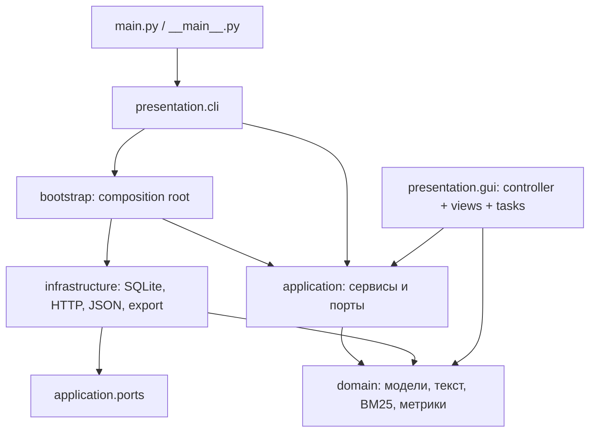

# Проект архитектуры рефакторинга

Документ составлен до изменения исполняемого кода. Он определяет целевую структуру,
ответственность компонентов, контракты, состояния и проверки перехода.

## 1. Цели и границы

Повысить связность внутри компонентов и снизить связанность между ними; обеспечить
единственные реализации сценариев для GUI и CLI; отделить расчёты от ввода-вывода;
сделать жизненный цикл ресурсов и границы транзакций явными.

Сохранить функции варианта 36, формулы, порядок выдачи при равных рангах, CLI-команды,
демо-коллекцию и формат экспортированных результатов. Рабочая SQLite-база должна
открываться без ручного переноса данных. Интерфейс остаётся настольным на Tkinter.

Нагрузка — небольшой учебный корпус. Применяется модульный монолит, слоистая
архитектура, Service Layer, Dependency Inversion и пассивные представления GUI.
Принципы SRP, ISP, явная инъекция через конструкторы, KISS и типизация применяются
к конкретным границам. Микросервисы, DI-контейнер, ORM, event bus и CQRS здесь
не решают существующей задачи и не включены в проект.

## 2. Найденные проблемы

| Проблема | Проектное решение |
| --- | --- |
| `main` парсит, открывает БД, исполняет все сценарии, сериализует и запускает GUI | Точка входа → CLI-адаптер → отдельные обработчики; сборка в `bootstrap` |
| GUI создаёт поисковый движок и вызывает SQLite/HTTP/экспорт | GUI получает готовые прикладные сервисы |
| `Repository` токенизирует и принимает прикладные решения | Индексирование в `CollectionService`; SQLite сохраняет подготовленный индекс |
| Вычисление метрик смешано с экспортом | Чистый `domain.metrics`; отдельные сериализатор, SVG и экспортёр |
| Поиск зависит от конкретного SQLite-репозитория | Чистый ranker принимает согласованный `CorpusSnapshot` |
| Произвольные словари с динамическими ключами проходят все слои | Типизированные неизменяемые модели; словари только на границе JSON/CSV |
| Импорт и групповое выставление оценок частично коммитятся | Один прикладной сценарий — одна транзакция |
| Оценка повторно читает корпус для каждого запроса | Один снимок корпуса и оценок на запуск оценки |
| Исключения SQLite и Tcl не согласованы с UI | Категории прикладных ошибок; перевод в адаптерах, отображение на границе |
| Фоновая очередь не имеет контракта закрытия | Typed task result, отмена Tk polling, игнорирование результатов после закрытия |
| Редактирование запроса может присвоить оценки не той разметке | Контроллер фиксирует запрос открытой разметки и проверяет его при сохранении |
| Пути и параметры разбросаны по модулям | Неизменяемая конфигурация и единственная точка сборки |

## 3. Слои и направление импортов



`domain` не импортирует application, infrastructure, presentation, sqlite3, urllib.request
или tkinter. `application` не импортирует infrastructure/presentation и не открывает
ресурсы. `presentation` не создаёт репозиторий и не исполняет SQL/HTTP. Только
composition root знает одновременно конкретные адаптеры и сервисы.
Форматирование табличных метрик вынесено в общий модуль представления результатов:
оно используется GUI и экспортёром, не вычисляет метрики и не выполняет I/O.

Целевая структура:

```text
main.py                           # делегирование запуска
ir_system/
  __main__.py                     # python -m ir_system
  config.py                       # пути и HTTP-параметры
  bootstrap.py                    # wiring и context manager ресурсов
  reporting.py                    # общий маппинг метрик для UI и экспорта
  visualization.py                # общий внешний адаптер Matplotlib Figure
  domain/
    errors.py                     # категории ожидаемых ошибок
    models.py                     # документы, снимок, параметры, отчёты
    text.py                       # нормализация и английский анализатор
    ranking.py                    # чистые BM25 и TF-IDF
    metrics.py                    # метрики ранжирования и усреднение
  application/
    ports.py                      # узкие Protocol-контракты
    services.py                   # коллекция, поиск, разметка, оценка, экспорт
  infrastructure/
    sqlite.py                     # persistence, транзакции, схема
    web.py                        # HTTP и HTML
    fixtures.py                   # JSON → типизированная коллекция
    reporting/
      serialization.py            # DTO → стабильный формат отчёта
      exporter.py                 # HTML/CSV/JSON/SVG/PNG на диске
  presentation/
    cli.py                        # argparse, вывод, код завершения
    commands.py                   # отдельные CLI-обработчики
    gui/
      window.py                   # оболочка, меню, диалоги
      tabs.py                     # пассивные представления трёх вкладок
      widgets.py                  # общие таблицы и график
      controller.py               # события, состояние экрана, сервисы
      tasks.py                    # один сетевой worker + очередь + polling
      help.txt                    # справка
```

## 4. Компоненты и контракты

### Предметные модели

`DocumentDraft(url,title,text)` валидирует обязательные поля и HTTP(S)-ссылку.
`Document` хранит прежние поля, ID и UTC-время. `IndexedDocument` объединяет draft,
неизменяемые частоты и время; его создаёт сервис коллекции до обращения к БД.
`CorpusSnapshot` содержит документы и postings в неизменяемых коллекциях,
число документов и среднюю длину. Снимок отделяет вычисления от хранения.
`SearchResult`, `Keyword`, `PrecisionRecallPoint`, `MetricValues`, `QueryEvaluation`,
`EvaluationReport`, `DemoCollection` заменяют нетипизированные payloads.
`BM25Parameters` валидирует конечность чисел, k1>0 и 0<=b<=1.

### Порты приложения

- `DocumentReader`: список/получение документа и согласованный снимок корпуса.
- `DocumentWriter`: сохранение подготовленного индекса, удаление документов.
- `JudgmentStore`: запросы, чтение и запись оценок.
- `TransactionManager`: контекст транзакции; поддерживает вложенные обращения
  без промежуточного commit (SQLite SAVEPOINT).
- `DocumentFetcher`: URL → `DocumentDraft`; без записи в БД.
- `CollectionSource`: JSON → валидированный `DemoCollection`; без записи в БД.
- `ReportExporter`: `EvaluationReport` + каталог → путь HTML.

Один SQLite-адаптер реализует связанные persistence-порты. Сервисы получают лишь
используемые контракты, не весь контейнер приложения и не открытое соединение.
Публичное поле `connection` исключается. Контекст runtime владеет закрытием адаптера.

### Сценарии и ответственность сервисов

`CollectionService`: documents/get_document, fetch, add, delete_many, import_demo. Нормализует
и индексирует документы, использует внедрённые clock и анализатор. Импорт сначала
полностью проверяется и индексируется, затем сохраняется вместе с разметкой атомарно.
Сетевой fetch отдельно от add позволяет сохранить SQLite в основном потоке GUI.

`SearchService`: получает снимок, нормализует запрос, вызывает чистый ranker;
keywords использует ту же текущую статистику. Ranker не получает репозиторий.

`JudgmentService`: нормализует текст запроса; валидирует grade и существование всех
ID; сохраняет групповую оценку атомарно. Пустые и повторяющиеся ID не создают запросы.

`EvaluationService`: проверяет k и список запросов; внутри read-транзакции читает
один снимок и все оценки; требует полной разметки; ранжирует тот же снимок по всем
запросам, вычисляет метрики и агрегирует неизменяемый отчёт. Экспорт вынесен в
`ReportService`, который зависит только от порта экспортёра.

### Представление

CLI: parser отвечает за форму аргументов; handlers — за выбранную команду и вывод;
run — за выбор DB/in-memory режима, wiring, перевод ожидаемой ошибки в exit code 1.
Сбой создания runtime тоже входит в обработку ошибок. При неожиданной ошибке
диагностика сохраняет traceback через logging. Ошибки не подавляются как успех.

GUI: Window и вкладки строят виджеты и показывают переданные модели. Controller
привязывает события, хранит последний отчёт и запрос открытой разметки, инвалидирует
выдачу/отчёт после изменения корпуса или оценок. Расчёты в GUI отсутствуют.
Общие виджеты инкапсулируют selection IDs, прокрутку, заполнение и очищение.
ChartsWidget занимается только рисованием. Диалоги принадлежат представлению.

## 5. Данные, транзакции и совместимость

Таблицы/колонки SQLite сохраняются. Версия схемы вводится через `PRAGMA user_version`:
0 — существующая схема, 1 — тот же формат с версией. Более новая версия отклоняется
понятной ошибкой. Новое приложение не переиндексирует и не очищает рабочую БД.
Токенизация и область title+text остаются прежними, поэтому старый индекс совместим.

Атомарные операции: добавление/обновление документа+postings, удаление группы,
оценка группы, весь импорт демо. Rollback распространяется на вложенные операции.
При изменении текста оценки документа удаляются; неизменённый документ сохраняет
оценки и исходное added_at. Внешние ключи и каскады сохраняются.

Отчёт получает отдельный явный сериализатор. JSON сохраняет названия `AP`, `MAP`,
`RR`, `MRR`, `P@k`, `nDCG@k`, прежнюю структуру и численные соглашения. CSV/HTML
используют тот же маппинг, чтобы колонки GUI и экспорта не расходились.
Файлы отчёта готовятся во временном каталоге и публикуются заменой отдельных файлов;
это предотвращает частично записанный HTML-файл, но не обещает атомарность набора файлов.

## 6. Ошибки и жизненный цикл

`ValidationError`, `NotFoundError`, `StorageError`, `FetchError`, `ExportError`
наследуются от `ApplicationError`. Domain/app порождают смысловые ошибки;
адаптеры переводят свои ожидаемые исключения, сохраняя cause через `raise ... from`.
GUI/CLI показывают пользователю сообщения на единственной внешней границе.

Состояния фоновой загрузки: idle → running → success/failure → idle; из любого
состояния можно перейти в closed. Worker выполняет только HTTP, никогда не Tk/SQL.
Результат типизирован. Close отменяет запланированный polling и запрещает callback
после уничтожения окна; сетевой daemon-поток может закончить текущий timeout,
не удерживая завершение приложения. Отмена не выдаётся за остановку HTTP-запроса.

## 7. План реализации и критерии приёмки

1. Зафиксировать baseline: 17 существующих тестов проходят, отчёт демо сохранён.
2. Создать domain-модели и чистые алгоритмы; перенести тесты ручных формул.
3. Реализовать порты, SQLite/HTTP/fixture адаптеры и прикладные сервисы.
4. Выделить представление метрик, сериализацию, графики и экспорт.
5. Создать composition root и тонкую точку входа, сохранить CLI.
6. Разделить GUI на views/controller/widgets/tasks, проверить закрытие worker.
7. Перенести существующие поведенческие тесты на новые публичные контракты;
   добавить rollback, границы ошибок, сохранение старой БД, CLI и архитектурные проверки.
8. Сравнить отчёт с baseline целиком, обновить README и проверить GUI.

Критерии: прежний численный отчёт воспроизводится; данные существующей БД остаются;
CLI сохраняет команды и выходные форматы; main делегирует запуск; domain/app не
зависят от адаптеров; GUI не выполняет HTTP/SQL; rollback и закрытие ресурсов проверены;
вся автоматическая проверка выполняется без Интернета и графической сессии,
GUI smoke проверяется отдельно. Применение PEP 8, type hints и явных исключений
проверяется ревью и доступными статическими инструментами, без внедрения зависимостей в runtime.

## 8. Основания решений

- Martin Fowler: [Presentation Domain Data Layering](https://martinfowler.com/bliki/PresentationDomainDataLayering.html).
- Martin Fowler: [Service Layer](https://martinfowler.com/eaaCatalog/serviceLayer.html).
- [PEP 544: Protocols](https://peps.python.org/pep-0544/) — структурные интерфейсы Python.
- [PEP 8](https://peps.python.org/pep-0008/) — соглашения оформления Python-кода.

Это проект конкретной системы, а не заявление о сертификации по стандарту:
в данном масштабе важны проверяемые зависимости, транзакции и ответственность.

## 9. Результаты реализации и проверки

Проект реализован. Прежние смешанные модули удалены, их функции распределены
между указанными слоями; параллельных старых реализаций в пакете нет.
Маппинг метрик находится в общем `ir_system/reporting.py`, чтобы infrastructure
и presentation не импортировали друг друга. SQLite реализует Protocol-контракты
структурно; совместимость проверяется mypy в composition root.

- 44 автоматических теста проходят. Исходные поведенческие проверки перенесены
  на новые публичные контракты и дополнены проверками транзакций и архитектуры.
- Весь JSON-отчёт учебной коллекции совпадает с исходным эталоном,
  включая выдачу, отдельные метрики, средние значения и PR-кривые.
- Ruff check и format check проходят; mypy не находит ошибок в 31 файле пакета.
- Отдельный GUI smoke проверяет коллекцию, поиск, метрики, графики, экспорт,
  разметку, изменение запроса, просмотр документа и справку.
- Копия рабочей базы с 12 документами открыта новым runtime; содержимое всех
  четырёх таблиц до/после совпало. Рабочая база использовалась только для чтения.

Ограничение снимков остаётся явным: они содержат весь небольшой корпус и индекс.
Для большого корпуса следует изменить реализацию чтения кандидатов, сохранив
границы алгоритма ранжирования и прикладных сценариев.

## 10. Уточнение оценки и графиков по РОМИП’2004

После первоначального рефакторинга появился локальный источник
`2004_romip_metrix.pdf`. Проект изменений до реализации находится в
[ROMIP_METRICS.md](ROMIP_METRICS.md). По запросу пользователя контракт метрик
изменён; этот раздел уточняет прежнее требование сохранить исходный формат отчёта.

- `MetricValues` содержит шесть поисковых метрик; `RetrievalCounts` — целые
  диагностические количества отдельно от долей.
- `EvaluationService` исключает запросы с R=0 и сохраняет причины в отчёте;
  средние и средняя TREC строятся только по допустимым запросам.
- Удалён произвольный k: P@5 и P@10 вычисляются одновременно. JSON имеет версию 2.
- `visualization.py` — общий внешний адаптер Figure. Domain/application
  не импортируют его или Matplotlib. Presentation и infrastructure используют
  общий модуль, не импортируя друг друга.
- Tkinter использует FigureCanvasTkAgg, экспорт — FigureCanvasAgg без pyplot
  и переключения глобального backend. Собственный SVG-построитель удалён.
- Качество разделено на разметку, результаты и графики. Переключатели изменяют
  представление готового отчёта без повторного расчёта и обращения к БД.
- Экспорт добавляет PNG, CSV исключений, пояснения и контекст эксперимента.
  Подготовка staging и публикация HTML последним сохраняются.

Проверки раздела 9 описывают состояние после первого рефакторинга.
Эталон и рисунки reports/demo обновлены под РОМИП. SQLite, документы и
независимая экспертная разметка сохраняются.

Актуальная проверка: 57 автоматических тестов, Ruff check/format и mypy
для 31 файла проходят. GUI smoke проверяет выбор графика и запроса,
результаты и экспорт; PNG просмотрены отдельно для проверки читаемости.
