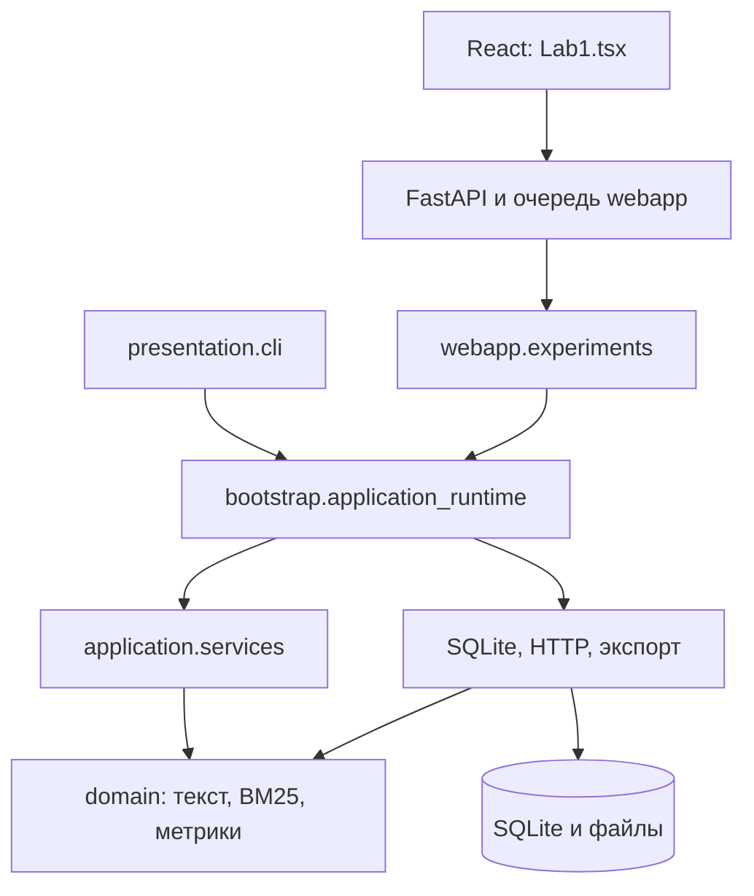

# Архитектура первой лабораторной

Приложение разделено на вычислительное ядро, прикладные сценарии, адаптеры
и представление. Веб-интерфейс и консоль вызывают одни и те же сервисы.

## Карта файлов

| Файл | Ответственность |
|---|---|
| `main.py`, `__main__.py` | Тонкие точки запуска |
| `ir_system/config.py` | Путь базы, демо, BM25, ограничения загрузки |
| `ir_system/bootstrap.py` | Создание и соединение реализаций, закрытие базы |
| `domain/models.py` | Документы, индекс, результаты поиска, параметры и отчёты |
| `domain/text.py` | Токенизация, частоты, уникальные термины запроса, проверки |
| `domain/ranking.py` | Чистые BM25 и TF-IDF |
| `domain/metrics.py` | Precision/Recall/AP/P@5/P@10/R-precision и интерполяция |
| `application/ports.py` | Protocol-контракты хранилища, загрузчика и экспортёра |
| `application/services.py` | Коллекция, поиск, экспертная разметка, оценка и экспорт |
| `infrastructure/sqlite.py` | Схема, SQL, транзакции, снимок корпуса |
| `infrastructure/web.py` | Ограниченная HTTP(S)-загрузка и извлечение текста |
| `infrastructure/fixtures.py` | Учебная коллекция из JSON |
| `infrastructure/reporting/` | HTML/JSON/CSV/SVG/PNG, подготовка файлов экспорта |
| `reporting.py`, `visualization.py` | Имена показателей и построение графиков |
| `presentation/cli.py`, `commands.py` | Команды, вывод и обработка ошибок |
| `../../webapp/frontend/src/Lab1.tsx` | Формы и отображение результатов в браузере |
| `../../webapp/experiments.py` | Адаптер вызовов первой лабораторной для веба |

## Путь поиска

Кнопка отправляет action/query/k1/b. Сервер ставит опыт в очередь и вызывает
`SearchService.search`. Анализатор выделяет уникальные термины, репозиторий
создаёт согласованный `CorpusSnapshot`, ранжировщик возвращает `SearchResult`.
Веб-слой сохраняет JSON и состояние опыта. Браузер получает результат опросом API.

## Хранение

Таблицы `documents`, `postings`, `queries`, `judgments` хранят тексты, инвертированный
индекс и оценки для пар запрос/документ. Внешние ключи и каскадное удаление включены.
Добавление и индексирование, импорт демо и групповые изменения атомарны.
Вложенные транзакции используют SAVEPOINT. Изменение текста аннулирует прежние оценки.

Веб-версия использует `webapp/work/search.sqlite3`, консоль — базу из AppConfig.
При первом запуске веба существующая база копируется через SQLite backup.
Соединения создаются в вызывающем потоке и закрываются context manager.
Веб-адаптер сериализует обращения к коллекции через RLock, поскольку репозиторий
проверяет и инициализирует схему при открытии каждого соединения.

## Зависимости и проверки

`domain` не импортирует представление, хранилище или графические библиотеки.
`application` обращается к инфраструктуре через Protocol-контракты.
Bootstrap явно передаёт реализации; глобального репозитория и соединений между потоками нет.

Тесты проверяют предметные расчёты, транзакции, сохранность отчёта при ошибке,
архитектурные границы, CLI и фиксированный демо-эталон. Общие веб-тесты проверяют
очередь, конкурентные чтения/записи, историю, файлы и реальные браузерные сценарии.
