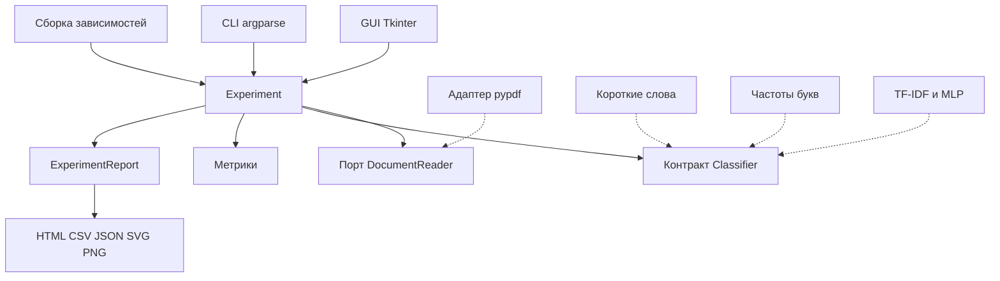
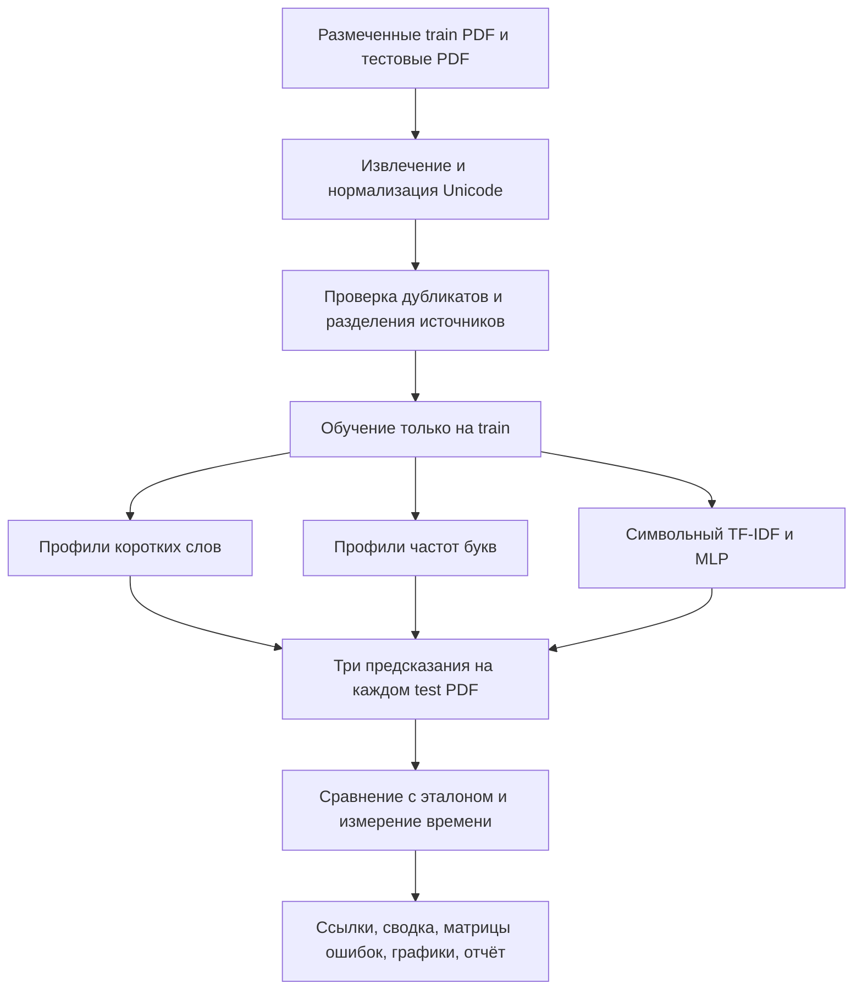

# Автоматическое распознавание языка текста

Лабораторная работа №2, вариант 36. Языки: испанский и английский. Вход: PDF.
Методы: коротких слов, алфавитный и нейросетевой.

## Цель и постановка задачи

По размеченному тренировочному корпусу построить языковые профили,
распознать язык каждого тестового документа и сравнить методы по точности и времени.
Предусмотрены GUI, активные ссылки на исходные документы, справка, экспорт и печать.

## Корпус

48 PDF, по одной странице A4, около 2400 символов в каждом:
32 обучающих и 16 тестовых. Языки представлены поровну.

| Роль | Язык | Произведения | PDF |
|---|---|---|---|
| Train | EN | Lewis Carroll, Alice; Jane Austen, Pride and Prejudice | 16 |
| Train | ES | Miguel de Cervantes, Don Quijote; Benito Pérez Galdós, Marianela | 16 |
| Test | EN | Arthur Conan Doyle, The Adventures of Sherlock Holmes | 8 |
| Test | ES | Pedro Antonio de Alarcón, El sombrero de tres picos | 8 |

Источник — Project Gutenberg. Полные библиографические сведения, ссылки и SHA-256
сохранены в [provenance.json](../data/demo/provenance.json); оригиналы с лицензией —
в `data/demo/sources`. Ни произведения, ни авторы не пересекаются между train и test.
Отрывки выбирались по заранее заданным позициям до оценки качества; параметры
классификаторов по тестовым ответам не подбирались.

Размер извлечённого обучающего текста:
EN — 39 466 байт, ES — 39 355 байт, всего 78 821 байт.
Таким образом, и каждый языковой корпус, и общий корпус находятся в диапазоне 20–120 KiB.
В PDF нет заголовков с эталонными метками языка.
Из испанского учебного издания исключены английское предисловие, словарь и комментарии.

## Структура системы

- `domain`: модели данных, Unicode-предобработка, профили слов/букв, метрики.
- `application`: единый сценарий чтения, проверки разделения, обучения и оценки.
- `infrastructure`: PDF, JSON-манифест, scikit-learn, экспорт.
- `presentation`: интерфейс и CLI; поток с очередью сообщений не обращается к Tk.
- `bootstrap`: создание конкретных компонентов; импорт нейросети отложен.
- `tools`: воспроизводимое получение источников и создание PDF.
Постоянная БД не нужна: коллекция описывается манифестом, результаты сохраняются в файлы.

Основные структуры: CorpusEntry (путь/роль/язык/источник), Document (текст/страницы/хеш),
Prediction (язык/оценки/тип шкалы/объяснение), ResultRow (результат PDF),
ExperimentReport (параметры/профили/обучение/метрики/версии/предупреждения).
Текстовые корпуса/профили остаются в памяти на время эксперимента.

## Алгоритмы

Готовая SVG-схема для печати включена в HTML-отчёт.

### Короткие слова

После NFC/casefold извлекаются Unicode-слова с сохранением апострофов и диакритики.
Слова длиной до 5 символов включаются в профиль языка, если встречаются не менее 4 раз.
V — объединение профилей, N_L — сумма оставленных частот языка L, alpha=0.5.

`P(w|L) = (count(w,L)+alpha)/(N_L+alpha*(|V|+1))`

Дополнительная категория соответствует неизвестным словам.
Для коротких слов входного документа рассчитывается:

`score(L) = -sum(log(P(w|L)))/число_коротких_слов`

Выбирается язык с минимальным score. Логарифмы предотвращают потерю точности при
перемножении многих малых вероятностей. Отказ — нет известных коротких слов или равные оценки.
Частоты здесь являются нормированными весами вероятностной модели, а не уверенностью в ответе.

### Алфавитный метод

Общий алфавит — a–z, á, é, í, ó, ú, ü, ñ.
Для документа и каждого языкового train-корпуса строится частота каждой буквы.
`distance(L) = sum_c |f_document(c)-f_language(c)|`.
Выбирается минимальное расстояние.

Это статистическая конкретизация алфавитного метода для близких алфавитов.
Отсутствие ñ или ударных гласных не считается доказательством английского.
Метод учитывает и соотношение обычных латинских букв; порядок букв не учитывается.

### Нейросетевой метод

Каждый train-PDF делится на непересекающиеся блоки до 80 слов; короткий хвост (<10) отбрасывается.
В контрольном запуске получилось 190 фрагментов.
На них строится словарь символьных n-грамм 2–4 и TF-IDF (не более 3000 признаков).
MLP: 32 скрытых нейрона, ReLU, L-BFGS, alpha=0.01, максимум 300 итераций, seed=36.
Фактически обучение сошлось за 19 итераций без предупреждений.

Распознавание использует один вектор целого тестового документа.
Модель выдаёт оценки классов EN/ES. Они не калиброваны и не используются
как обещание вероятности правильного ответа.

Для всех методов общие отказы: менее 10 букв или более 20% букв вне поддерживаемого алфавита.
Этот фильтр не обнаруживает надёжно все третьи языки или смешанную речь.

## Метрики и результаты

Источник чисел: [metrics.json](../reports/demo/metrics.json).
Точное время зависит от повторного запуска, поэтому актуальные значения находятся в HTML/CSV.

На подготовленных 16 PDF все три метода распознали 16/16: Accuracy=1.0, Macro-F1=1.0.
Для каждого метода матрица по эталону EN/ES и ответу EN/ES/отказ:
`[[8,0,0],[0,8,0]]`.

В первоначальном контрольном запуске среднее время распознавания составляло примерно:
короткие слова — 0.51 мс; алфавитный — 0.40 мс; нейросеть — 5.63 мс.
Обучение: примерно 0.006, 0.006 и 0.293 с соответственно.
Время включает преобразование признаков внутри predict; для MLP также входит управление
лимитом вычислительных потоков. Это время реализации целиком, а не только умножения матриц.

Для каждого документа выполняется один прогрев и пять измеряемых вызовов predict;
берётся медиана, затем среднее медиан по документам.
Чтение PDF и обучение измеряются отдельно; импорт библиотек не входит в эти интервалы.
Отказы считаются ошибками при наличии эталона; неразмеченные PDF исключены из accuracy/F1.
Precision/Recall/F1 по каждому языку доступны в JSON, сводка F1 — в CSV.

## Проверки и обработка ошибок

15 автоматических тестов проверяют ручные формулы, Unicode, одинаковые профили,
неизвестные слова, неподдерживаемую письменность, пустой/повреждённый/парольный PDF,
независимость train/test, отсутствие обучения словаря по test, метрики,
сериализацию и экспорт. GUI smoke проверяет настоящий Tk, worker, таблицу, график,
экспорт и инвалидирование результата. Ruff и mypy пройдены.
Печать предоставляется через браузер; физический принтер не проверялся.

## Библиотеки

- pypdf — извлечение текста и числа страниц; OCR не выполняет.
- scikit-learn — TfidfVectorizer и MLPClassifier.
- NumPy/SciPy — численные операции ML; threadpoolctl — воспроизводимое ограничение потоков.
- Matplotlib — графики, SVG/PNG, встраивание в Tkinter.
- Tkinter/ttk — GUI, стандартная библиотека Python.
- ReportLab — только подготовка одностраничных учебных PDF.
- truststore — HTTPS через системное хранилище доверенных сертификатов.
- pathlib/json/csv/logging/unittest/threading/queue — стандартная библиотека.

Проверенные версии закреплены в requirements-lock.txt.
Функциональные источники: [pypdf](https://pypdf.readthedocs.io/en/stable/user/extract-text.html),
[scikit-learn MLP](https://scikit-learn.org/stable/modules/neural_networks_supervised.html).

## Выводы и перспективы

На этой коллекции простой алфавитный профиль и короткие слова обеспечивают ту же точность,
что MLP, при меньших затратах времени. Нейросеть здесь не показала преимущества по точности.
Набор мал, литературный, по одной тестовой книге на язык; его отрывки зависимы.
По этим данным нельзя делать вывод о превосходстве метода в общем случае.
Следующий эксперимент — независимые тексты разных жанров, короткие фрагменты,
ошибки OCR и смешанные языки; только после этого обоснован подбор параметров
на отдельной валидационной выборке.
