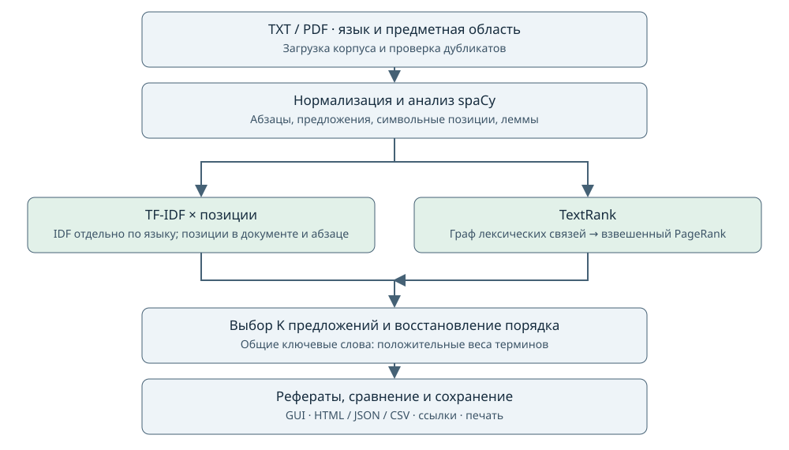

# Лабораторная работа №3. Автоматическое реферирование документов

**Вариант 27.** Языки: английский и испанский. Области: научные медицинские
статьи и критика произведений изобразительного искусства.
Реализованы sentence extraction по методичке и сравнительный TextRank.
По уточнению пользователя OSTIS необязателен и заменён TextRank.
Ошибочная строка об исключении латинских слов не применяется к EN/ES.

## Коллекция

Вход — подготовленные TXT-фрагменты реальных источников; поддержан импорт PDF.
Корпус включает по одному тексту для каждого сочетания языка и области.
Использованы медицинские статьи HPACC (PLOS Medicine, 2025) и
Izquierdo Martínez et al. (2023), глава Truth in Painting Джона Ван Дейка
и испанский разбор техники и интерпретаций «Менин» из Wikipedia.
Wikipedia прямо допускается методичкой как источник коллекции.

Тексты приведены к сопоставимому объёму: 12 163–13 111 символов, отношение 1.078.
«Например, 10 страниц A4» трактуется как пример объёма; равенство числа страниц
не требуется. Для сопоставимости выбран размер в символах.
Обрабатываются фрагменты, а не полные публикации. Результат относится к фрагменту:
сведения из последующих разделов статьи в реферат попасть не могут.

Сохранены полные оригиналы, правила отбора, лицензии и контрольные суммы.
Описание: [data/demo/README.md](../data/demo/README.md);
машинные сведения: [provenance.json](../data/demo/provenance.json).
Снимки получены 24 октября 2026 года. Медицинские статьи — CC BY 4.0;
Wikipedia — CC BY-SA 4.0, с атрибуцией авторов через историю статьи;
Gutenberg сохраняет условия распространения внутри исходного файла.

## Структура и данные

| Слой / модуль | Ответственность |
|---|---|
| domain/models.py | Неизменяемые записи источника, документа, предложения, ранжирования и результата |
| domain/ranking.py | Корпусная IDF, формулы методички, отбор и ключевые слова |
| application/experiment.py | Общая предобработка, сравнение двух Ranker через Protocol, отмена между этапами |
| infrastructure/nlp.py | spaCy, границы предложений, леммы и исходные символьные смещения |
| infrastructure/textrank.py | Лексический граф и взвешенный PageRank |
| infrastructure/documents.py | TXT/PDF, манифест, нормализация и проверка дубликатов |
| infrastructure/export.py | Переносимый HTML, JSON/CSV, анкета эксперта, копии входных текстов |
| presentation | CLI и Tkinter; фоновый поток передаёт сообщения через Queue |
| bootstrap.py | Сборка зависимостей и ротация журнала ошибок |

Source хранит путь, язык, область, название, URL, атрибуцию и лицензию.
Document — нормализованный текст и предупреждения загрузчика.
Sentence — номер, исходный текст, start/end, границы абзаца, последовательность лемм
с повторами и число буквенных слов. Смещения относятся к нормализованной строке:
`text[start:end] == sentence.text`.
Корпусная статистика хранит N и df по языку.
Summary содержит все веса, выбранные индексы, ключевые слова, время и доли сжатия.
Experiment объединяет параметры, версии, результаты документов и предупреждения.

Не используются сервер, БД, наследование для каждого алгоритма или отдельный граф
ключевых слов. Алгоритмы подключены через небольшой Protocol.
Сложность TextRank: O(S²) сравнений предложений и память O(S+E) для графа.
Для учебных текстов предусмотрен предел 1500 предложений.

## Алгоритм



1. Проверить входные файлы и их метаданные; исключить точные дубликаты.
2. Нормализовать Unicode и пробелы, сохранив границы абзацев.
3. Обработать каждый абзац языковой моделью spaCy. Сохранить предложения
   без перефразирования, их позиции и леммы буквенных слов.
   Числа и стоп-слова исключить из признаков; в тексте реферата они сохраняются.
4. Построить df и IDF отдельно для EN и ES по всем загруженным документам.
5. Один раз вычислить веса терминов и общий список ключевых слов.
6. Выполнить оба метода на одних предложениях с одинаковым K.
7. Выбрать top-K, при равенстве предпочесть более раннее предложение.
   Восстановить порядок выбранных предложений в исходном документе.
8. Показать классический реферат и ключевые слова, сравнить время и сжатие,
   сохранить ссылки и результаты.

### Формулы методички

Формулы сверены с изображениями страницы 2 исходного PDF:
[formulas.png](formulas.png).

Для термина t в документе D:

```text
w(t,D) = 0.5 · (1 + tf(t,D) / tf_max(D)) · ln(N / df(t))
Score(S) = Σ[t ∈ V(S)] tf(t,S) · w(t,D)
Posd(S) = 1 − BD(S) / |D|
Posp(S) = 1 − BP(S) / |P|
Weight(S) = Score(S) · Posd(S) · Posp(S)
```

V(S) — множество терминов; tf(t,S) — число вхождений.
В коде эквивалентно суммируются веса по последовательности лемм с повторами.
BD/BP и длины измеряются в символах, не в словах и не в номерах предложений.
Используется натуральный логарифм. Выбор его основания меняет общий масштаб,
но не порядок предложений при одинаковом N.

IDF не сглаживается. Текущий документ входит в свой языковой корпус:
df не бывает нулевым для встреченного термина. При N=1 все веса равны нулю;
приложение предупреждает и выбирает первые предложения.
Ключевые слова — термины с наибольшими положительными w(t,D);
термины с нулевым весом не объявляются информативными.

Ручной контроль: D = «Alpha alpha beta.\n\nBeta common.» содержит 31 символ.
Другие два документа — «Beta common.» и «Common.».
N=3, tf_max(D)=2; df(alpha)=1, df(beta)=2, df(common)=3.
Получаем w(alpha)=ln3, w(beta)=ln1.5, w(common)=0.
Вес первого предложения: 2ln3+ln1.5.
Второе начинается в позиции 19 и является первым в своём абзаце:
его вес равен ln1.5 · (1−19/31). Эти значения проверяются тестами.

### TextRank

Основа — [Mihalcea & Tarau, 2004](https://aclanthology.org/W04-3252/).
Узлы — предложения. Рёбра неориентированные, вес положителен при пересечении лемм:

```text
sim(A,B) = |set(terms(A)) ∩ set(terms(B))| /
           (ln(len(terms(A))) + ln(len(terms(B))))
```

Лемматизация и удаление стоп-слов — явная адаптация исходного подхода.
Число terms учитывает повторы; числитель считает уникальные общие леммы.
Для двух однословных предложений знаменатель нулевой:
используется вес 1 при совпадении, иначе 0. Для пустого набора признаков вес 0.

Используется networkx.pagerank: alpha=0.85, max_iter=200, tol=1e−8,
атрибут weight. Нулевые рёбра и петли не создаются.
Изолированные узлы сохраняются. Если во всём графе нет рёбер,
применяется позиционный отбор с предупреждением.
Ошибка сходимости сообщается пользователю.
PageRank не использует корпусную IDF; общий список TF-IDF-ключей одинаков для обоих
режимов. Это сравнение методов извлечения предложений.

## Полученные результаты

Замеры ниже относятся к сохранённому запуску, K=10, ключевых слов=10.
Инициализация моделей и библиотек: 1.583 с;
построение языковых IDF: 0.659 мс.
Численные зависимости PageRank загружены до начала замеров документов.
Время ранжирования включает построение графа или весов предложений и отбор top-K;
предобработка измеряется отдельно. Вычисление ключевых слов общее и записано в JSON.

| Язык / область | Символов | Предложений | NLP, мс | Методичка, мс | TextRank, мс | Слов: методичка / TextRank | Jaccard |
|---|---:|---:|---:|---:|---:|---:|---:|
| en / medicine | 12261 | 65 | 288.45 | 0.186 | 5.175 | 23.9% / 20.4% | 0.250 |
| es / medicine | 12163 | 73 | 256.88 | 0.114 | 4.414 | 22.3% / 18.4% | 0.053 |
| en / art | 13037 | 106 | 353.38 | 0.132 | 7.518 | 15.3% / 15.1% | 0.176 |
| es / art | 13111 | 67 | 255.62 | 0.109 | 4.116 | 22.6% / 28.2% | 0.333 |

Это один запуск, без доверительных интервалов и оценки разброса.
NLP составляет основную часть обработки; TextRank дополнительно строит попарный
граф. Загрузка моделей при первом запуске показана отдельно.
Все восемь рефератов содержат по десять исходных предложений в исходном порядке.
Перечисленные библиотеки работают локально после установки.

Сжатие определяется долей сохранённых слов или предложений.
Jaccard — размер пересечения выбранных индексов, делённый на размер их объединения.
Это согласие методов, а не точность или полнота содержания.

При просмотре примеров позиционный метод преимущественно извлекает предложения
из начала документа и начала абзацев — прямое следствие множителей.
TextRank отдаёт предпочтение предложениям, связанным повторяющимися понятиями;
это может повышать тематическую концентрацию и одновременно сохранять повторы.
Например, медицинские ключи включают insulin/diabetes, а художественные —
art/truth и cuadro/velázquez. В рефератах могут оставаться зависимые от контекста
местоимения и вводные связки: методы не выполняют анафорическое разрешение.
Эти наблюдения не являются слепой экспертной оценкой и не доказывают превосходство
одного алгоритма.

**Оценка точности по эталонам пока не выполнена:** эталонные рефераты отсутствуют.
Не вычисляются вымышленные ROUGE или проценты «правильности».
В отчёте создана CSV-анкета с незаполненными полями для информативности,
связности и отсутствия повторов. Для каждого критерия: 1 — выраженная проблема,
3 — частичное выполнение, 5 — хорошее выполнение.
Эксперт должен сначала прочитать входной фрагмент, затем оценить оба реферата;
для более надёжного сравнения желательно привлечь двух независимых оценщиков.
Заполненные оценки сохраняются между экспортами; изменённые рефераты получают
другой файл анкеты.

## Проверки

Выполнено 25 октября 2026 года:

- 24 уникальных unittest: ручные формулы, позиции в абзаце, стабильный порядок,
  IDF по языкам, пустой словарь, один документ, пустой граф и ошибка сходимости.
- Интеграционные проверки настоящих моделей EN/ES, сохранения акцентов,
  PDF с текстом, пустого/повреждённого/защищённого PDF и ошибок входа.
- Экспорт: HTML-экранирование, ссылки, копии текста, JSON и сохранение анкет.
- Скрытый настоящий Tk: загрузка демо, фоновый расчёт, переключение метода,
  подсветка, экспорт и сброс устаревшего результата.
- Ruff check и format --check: прошли.
- Mypy: прошёл для 21 производственного/служебного Python-файла;
  тестовые файлы не включены в эту проверку.
- CLI --help проверен при прямом запуске из корня и из lab3;
  полный CLI-эксперимент создал итоговый отчёт.

Физическая печать, экспертная разметка и качество на широком корпусе не проверялись.
Команды воспроизведения приведены в [README.md](../README.md).

## Библиотеки и ограничения

spaCy использует en_core_web_sm и es_core_news_sm 3.8.0: токенизация, сегментация,
POS-контекст для лемм и стоп-слова. Общие модели не обучались специально на этих
медицинских и искусствоведческих текстах; ошибки сегментации/лемм возможны.
NetworkX и SciPy выполняют взвешенный PageRank.
PyMuPDF извлекает текстовые блоки PDF; они могут не совпадать с настоящими абзацами.
Tkinter предоставляет GUI; браузер — просмотр и печать HTML.
BeautifulSoup и truststore нужны только для подготовки/повторной загрузки корпуса.

Проверенные версии приведены в results.json; runtime-зависимости Windows/Python 3.12
зафиксированы в requirements-lock.txt (58 дистрибутивов).
Python: 3.12.6; spaCy: 3.8.16; NetworkX: 3.7.

По два документа на язык дают очень грубую IDF: общие для двух документов термины
обнуляются, а специфичные термины получают одинаковую IDF=ln2.
Таким образом, демонстрация проверяет работу алгоритмов и интерфейса,
но не даёт устойчивого ранжирования терминов или обобщения качества.
Корпус следует расширить несколькими независимыми текстами в каждой ячейке.

Перспективы: расширение и экспертная оценка корпуса, улучшение PDF-предобработки,
проверка сегментации на терминах и сокращениях, а затем снижение повторов.
Такие улучшения должны оставаться отдельными режимами, чтобы сохранялось
точное воспроизведение исходных формул методички.
