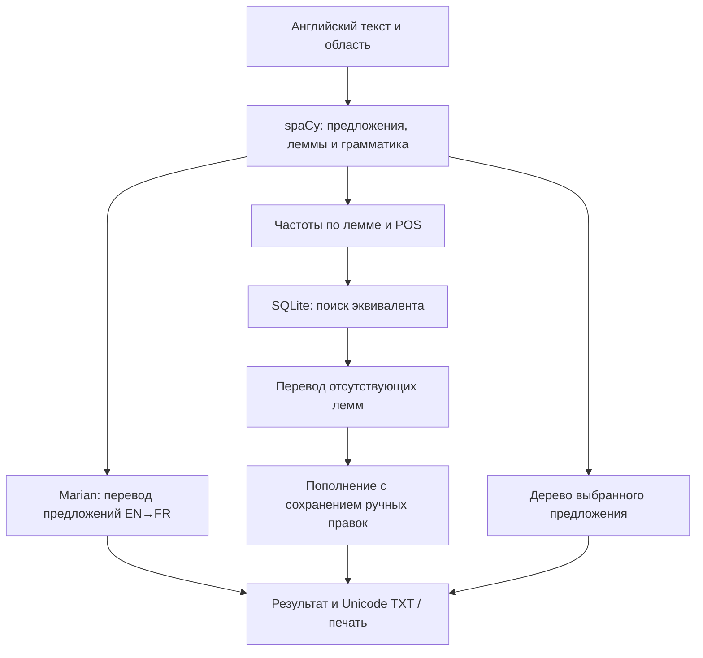

# Лабораторная работа №4. Автоматический машинный перевод текстов

**Вариант 12:** английский → французский; научные медицинские статьи
и критика произведений изобразительного искусства.

## Структура системы

| Слой / компонент | Назначение |
|---|---|
| domain/models.py | Токены, предложения, частотные записи, результат, проверка дерева и покрытие |
| application/translation.py | Анализ, перевод предложений, автоматическое пополнение словаря, отмена |
| application/ports.py | Контракты анализатора, переводчика и словаря |
| infrastructure/nlp.py | Английский spaCy: леммы, POS, теги, морфология, зависимости и смещения |
| infrastructure/marian.py | Локальный Marian EN→FR, разбиение длинных входов и контроль EOS |
| infrastructure/lexicon.py | SQLite-переводы и ручные правки, транзакции и закрытие соединений |
| infrastructure/grammar.py | Русские описания UPOS, пояснения Penn Treebank-тегов и связей |
| infrastructure/export.py | Unicode TXT, CSV, JSON, SVG и печатный HTML |
| presentation | CLI и Tkinter, две обязательные вкладки |
| tools | Закреплённая загрузка модели, подготовка примеров и воспроизводимые отчёты |

Зависимости собираются в bootstrap.py. Тяжёлые модели загружаются лениво.
GUI использует существующий TaskRunner из lab2: один рабочий поток,
очередь сообщений, обращения к Tk только из главного потока.
SQLite-соединение создаётся для каждой операции в вызывающем потоке,
транзакция завершается и соединение закрывается. Соединения между потоками не передаются.

### Использование весенних лабораторных

Из sprig_semester/1lab/core/lexical_analyzer.py адаптирована структура
«лемма → словоформы → частоты». Группировка расширена до (lemma, POS),
каждое употребление учитывается со своим контекстным тегом.
Исходная привязка одинаковой формы к первой найденной части речи не перенесена.
Из dictionary.py адаптированы пополнение, корректировка, поиск записи по ключу,
экспорт и сохранение. Порядок изменён с алфавитного на убывание частоты.

Из sprig_semester/3lab/backend/services/dependency.py адаптированы поля
text/lemma/pos/tag/dep/head, локальные индексы предложения и построение дерева.
Добавлены типы и проверка корня, индексов, связности и циклов.
Обход детей выполняется по заранее построенной таблице смежности.
Не используется эвристическая замена настоящего парсера.
Стек FastAPI/React/PostgreSQL и неисправная загрузка benepar не переносились:
требования покрыты настольным приложением и реальным деревом зависимостей spaCy.

## Основные алгоритмы

### Перевод текста

Используется [Helsinki-NLP/opus-mt-en-fr](https://huggingface.co/Helsinki-NLP/opus-mt-en-fr),
ревизия dd7f6540a7a48a7f4db59e5c0b9c42c8eea67f18.
Это нейронный encoder-decoder переводчик Marian; он не реализует правила
лингвистического трансфера вручную. Описание прямого/непрямого перевода в методичке
используется как теоретический контекст, конкретный способ реализации не ограничен.

Модель загружается через MarianTokenizer и MarianMTModel.
Устаревший translation pipeline не используется:
[документация Transformers](https://huggingface.co/docs/transformers/model_doc/marian).
Загрузка при работе выполняется только из локальной папки.
Веса получены с официального репозитория по фиксированной ревизии через HTTPS,
файлы и SHA-256 записаны в revision.json.
Модель распространяется под Apache 2.0 согласно её карточке.

Английский текст делится на абзацы и предложения. Каждое предложение кодируется
SentencePiece без усечения. Если оно длиннее 384 токенов, последовательность
разбивается на части, к каждой добавляется EOS. Все исходные токены передаются модели.
Используются CPU, 2 потока, beam search=4, do_sample=False, max_new_tokens=510.
Если в результате отсутствует завершающий EOS, возвращается ошибка:
частичный результат не объявляется полным переводом.
Переведённые предложения объединяются в исходном порядке и с исходными абзацами.
Между частями длинного предложения контекст может теряться.

### Частотный словарь и автоматическое пополнение

Для каждого токена spaCy сохраняются лемма, часть речи, Penn Treebank-тег,
UD-морфология, зависимость, head, start/end.
Словоупотреблением считается токен с хотя бы одной буквой.
Стоп-слова сохраняются: требование касается списка слов всего текста.

Группировка по (lemma, POS) сохраняет омонимию: record/VERB и record/NOUN —
разные записи. Внутри записи подсчитываются исходные словоформы, собираются
все встретившиеся теги и морфологические признаки.
Частота равна числу употреблений в текущем тексте, а не накопленной частоте БД.
Сортировка: −frequency, lemma, POS.

SQLite хранит эквивалент, origin=auto/manual и время обновления.
Ключ: (lemma, POS, domain, model+revision). Это не позволяет смешивать
разные части речи, области и версии модели.
Отсутствующие леммы переводятся отдельно; автоматическое обновление не заменяет
manual-записи. Кнопка «Автопополнение» также обновляет уже существующие auto-записи.
Ручная правка переживает повторный анализ и перезапуск приложения.
Сброс удаляет эквивалент до последующего заполнения.

Словарные эквиваленты не являются выравниванием токенов полного перевода:
изолированное слово не содержит контекста предложения.
Ручные правки словаря не выполняют строковую подстановку в нейронном переводе.
Это два различных результата системы, что отражено в справке.

### Подсчёт слов

source_words — сумма частот исходных словоупотреблений.
translated_source_words — сумма частот записей с непустым эквивалентом,
если он отличается от исходной леммы либо подтверждён вручную.
Совпавшая автоматическая строка получает статус review и исключается из покрытия.
Это консервативная политика: patient или composition могут быть правильными
французскими словами и войдут в покрытие после ручного подтверждения.

Число французских слов вычисляется отдельно Unicode-выражением с внутренними
апострофами и дефисами. Оно не подставляется вместо числа переведённых исходных слов.
Покрытие не измеряет правильность эквивалентов: неверный, но непустой
автоперевод может пройти это механическое условие.
Апострофные конструкции в английском могут быть разделены spaCy на токены,
поэтому счётчик относится к определённым выше словоупотреблениям.

### Синтаксическое дерево

Парсер en_core_web_sm определяет зависимости исходного английского предложения.
Индексы токенов и head переводятся из документных в локальные.
Корень имеет head=self; для остальных токенов строится список детей.
Проверяются единственность корня, отсутствие внешних ссылок, циклов и несвязных узлов.
Вторая вкладка отображает иерархию с тегами, морфологией и расшифровкой связей.
При экспорте сохраняется SVG выбранного дерева.
Это dependency tree, а не дерево составляющих.

## Данные и результаты

Подготовлены два коротких оригинальных учебных текста и два фрагмента реальных
источников из корпуса lab3. Реальные примеры включают первые три предложения
медицинского текста HPACC, PLOS Medicine, 2025
([DOI](https://doi.org/10.1371/journal.pmed.1004559), CC BY 4.0),
и первые шесть предложений главы Truth in Painting Джона Ван Дейка
([Gutenberg #72598](https://www.gutenberg.org/ebooks/72598)).
Правила отбора, авторство, ссылки и хеши сохранены в data/demo/provenance.json.
Авторы и лицензии реальных примеров включены в TXT/HTML-отчёты.

| Пример | Исходных слов | Покрыто | FR-слов | Анализ, с | Перевод, с | Словарь, с |
|---|---:|---:|---:|---:|---:|---:|
| medicine | 30 | 28 | 35 | 0.012 | 1.823 | 2.837 |
| art | 33 | 28 | 37 | 0.007 | 1.874 | 4.122 |
| source_medicine | 87 | 77 | 119 | 0.019 | 5.808 | 12.713 |
| source_art | 112 | 103 | 115 | 0.022 | 6.664 | 11.288 |

Замеры относятся к одному последовательному запуску с чистым временным
SQLite-словарём. Модели загружены один раз: инициализация первого примера
заняла 9.677 с, последующие использовали те же экземпляры.
Время словаря включает перевод новых изолированных лемм и операции БД;
эквиваленты, уже встречавшиеся в той же области, могут браться из кэша.
Выборка мала, повторные замеры и доверительные интервалы не рассчитывались.

Медицинский учебный пример переведён, в частности, как
«L'étude évalue la qualité de vie des patients diabétiques».
В реальном фрагменте переданы основная тема диабета, доступность лечения
и ограничения ресурсов. При этом аббревиатура LMICs в одном месте стала MIC:
терминологию и сокращения следует проверять вручную.

Художественный пример показывает ограничения модели: в учебном переводе
получилась неудачная конструкция «contraste avec ... avec ...».
В реальном фрагменте neigh/neighed передано некорректно (peser вместо ржания),
встречаются буквальные обороты и нарушения согласования.
Результаты сохранены как выдала модель, ошибки не исправлялись задним числом.
Таким образом, успешное выполнение программы не означает качественный перевод
сложной художественной прозы.

Статус review выделил как реальные спорные формы ('s, a, neigh), так и возможные
правильные совпадения patient, type, composition. Это объясняет, почему покрытие
ниже 100%, и почему его нельзя трактовать как процент правильно переведённых слов.
Автоматические эквиваленты the → des и a → a также показывают пределы
изолированного словарного перевода.

Эталонных французских переводов и независимой экспертной оценки нет;
BLEU/chrF и проценты точности не заявляются.
Для последующей оценки нужны эталонные переводы и проверка терминологии,
грамматики, полноты и стилистики в обеих областях.

## Результаты тестирования

Проверки от 25 октября 2026 года:

- 20 unittest: омонимия POS, формы и частоты, сортировка, проверка дерева,
  полное покрытие длинного входа частями, реакция на отсутствие EOS,
  SQLite-транзакции и освобождение файлов, сохранение manual-правок,
  разделение областей/моделей, отмена и подсчёт покрытия.
- Интеграция с настоящим spaCy: грамматика, локальные head, символьные позиции,
  абзацы и Unicode-экспорт. TXT содержит расшифровку тегов и BOM.
- GUI smoke с настоящим Marian и скрытым Tk: перевод, ручная правка,
  автоматическое обновление с сохранением правки, выбор дерева, экспорт
  и сброс результата при изменении текста.
- Ruff check и format --check: прошли.
- Mypy: 22 производственных/служебных файлов, тесты исключены.
- Прямой CLI-запуск проверен из корня и из lab4; создано четыре отчёта.

Физическая печать не проверялась; интерфейс печати реализован в браузере
для тех же данных, которые сохраняются в Unicode TXT.

## Выводы и улучшения

Программа реализует перевод, частотный грамматический словарь с автопополнением
и коррекцией, синтаксическое дерево, Unicode-сохранение и печать.
Переиспользована логика весенних работ с исправлением неоднозначности POS
и добавлением строгой проверки дерева.

Основные ограничения — качество общего переводчика на терминах и старой
художественной прозе, отсутствие контекста при переводе лемм и разрыв контекста
в особо длинных предложениях. Следующие улучшения: корпус эталонных переводов,
терминологические словари по областям, контекстное выравнивание слов,
экспертная постредактура и отдельная проверка сегментации на сокращениях.
Выбор области сейчас разделяет SQLite-эквиваленты, но не изменяет веса Marian.

Стек: spaCy + en_core_web_sm 3.8.0, PyTorch, Transformers, SentencePiece,
Sacremoses, SQLite, Tkinter. Runtime Windows/Python 3.12 закреплён в
requirements-lock.txt (66 дистрибутивов).
Версии модели и библиотек, времена и грамматические данные сохранены в results.json.
Команды запуска и проверки: [README.md](../README.md).
