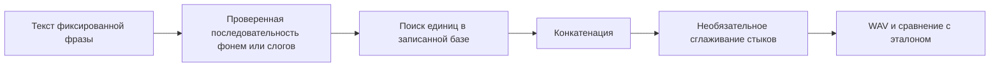

# Лабораторная №7. Компиляционный синтез

**Состояние: рецепты и инструменты подготовлены, речевая база отсутствует.**

## План по методичке

| Пункт PDF | Действие | Состояние |
|---|---|---|
| 3.1 | Методы синтеза, фонемные тексты | Теоретическая подготовка |
| 3.2 | 4 эталона: утверждение, вопрос, две синтагмы, перечисление | Ожидается references.wav |
| 3.3.1 | База фонем из материалов работы 5, проверка транскрипций | Границы и проверка ожидаются |
| 3.3.2 | Сборка 4 фраз по фонемам | Не выполнена без банка |
| 3.3.3 | Сравнение с эталонами | Ожидается прослушивание |
| 3.3.4 | Улучшение одного результата: границы, уровень, стыки | Ожидаются реальные фрагменты |
| 3.3.5 | База слогов, сборка и сравнение трёх вариантов | Ожидается syllable_bank.wav |
| 3.3.6* | Дополнительная просодическая обработка | Исключена по согласованию |
| 3.4 | Структура компилятора и общий вывод | Структура подготовлена, экспериментальный вывод ожидается |

## Эталоны и транскрипции

1. Саша кушал кашу.
2. Саша кушал кашу?
3. Саша кушал кашу, а Маша пила сок.
4. Мама, папа и Саша пили сок.

recipes.json содержит для каждого текста фонемный и слоговой черновики.
Используется упрощённый учебный фонемный алфавит, а не точная IPA-транскрипция.
Редукции, коартикуляция, мягкость и реальная длительность сверяются по записи.
42 единицы в шаблоне соответствуют перечню методички, а не претензии на
единственную теоретическую инвентаризацию русских фонем.

До проверки рецепты имеют DRAFT_TRANSCRIPTION_REVIEW_REQUIRED.
Для сборки необходимо вручную установить REVIEWED.
Утверждение и вопрос имеют одинаковую последовательность сегментов:
наивная конкатенация одних и тех же единиц сама не восстановит разницу интонации.
Это наблюдаемое ограничение базовой системы, которое нужно обсудить после прослушивания.

## Алгоритм

Временные границы берутся только из проверенной разметки.
Частоты единиц должны совпадать; несовпадение выдаёт ошибку,
ресемплинг выполняется явно. Исходные WAV сохраняются.
Базовый режим — прямая склейка. Экспериментальный crossfade до 50 мс
перекрывает соседние сигналы и уменьшает общую длительность.
Малое перекрытие может уменьшить щелчок, но также смазать согласный:
качество проверяется, а не предполагается.

Для пункта 3.3.4 сначала сравниваются реальные границы, паузы, уровни
и спектральные стыки. Сглаживание — один из способов, не обязательное улучшение.
Для 3.3.5 используется отдельно записанный банк слогов;
в нём сохраняется часть внутрислоговой коартикуляции.

## Таблица сравнения

| Фраза | Эталон | Из фонем | После обработки стыков | Из слогов | Разборчивость / естественность / замечания |
|---|---|---|---|---|---|
| 1 | Ожидается | — | — | — | — |
| 2 | Ожидается | — | — | — | — |
| 3 | Ожидается | — | — | — | — |
| 4 | Ожидается | — | — | — | — |

Объективно фиксируются длительности, параметры операций и графики.
Слуховые оценки заполняются человеком после сравнения; пустые оценки не равны нулю.

## Границы системы

Это компилятор для четырёх заранее заданных фраз.
Для неограниченного словаря нужны нормализация текста, расстановка ударений,
полноценное контекстное преобразование в произношение, покрывающая база единиц,
выбор вариантов единиц, управление длительностью/просодикой и постобработка.
Необязательный опыт 3.3.6* здесь не выполняется.
Экспериментальный общий вывод: **не заполнен до реальных записей**.
