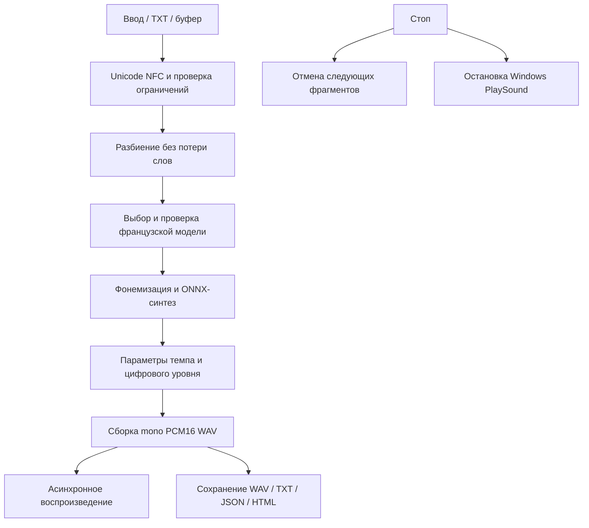

# Лабораторная №8. Автоматизированная система синтеза речи

**Вариант 8:** французский язык, сочинения по литературе.

## Требования и реализация

| Требование методички | Реализация |
|---|---|
| Ввод или буфер или указатель мыши другого приложения | Ввод текста и явная вставка из буфера; выбранные альтернативы методички |
| Воспроизведение речевого сигнала | Синтез WAV, затем асинхронное воспроизведение Windows |
| Выбор голоса | Две модели французского языка: Siwis и Tom |
| Настройки темпа и громкости | Темп 0.5–2.0×, громкость 0–100% |
| Простой интерфейс | Одно окно, примеры, Read/Stop/Replay/Save, справка |
| Описание/алгоритмы/тесты/анализ | Данный отчёт, сохранённые измерения и аудио |

Собственные записи пользователя не нужны.
Лабораторные №5–7 отложены по его просьбе и не являются зависимостью этой работы.

## Выбранные технологии

Проверка pyttsx3.getProperty("voices") через SAPI5 обнаружила Microsoft Irina
(ru-RU) и Microsoft Zira (en-US). Французский голос этим движком недоступен.
Методичка разрешает нейросетевые библиотеки, поэтому выбран локальный
[Piper](https://github.com/OHF-Voice/piper1-gpl).
Установка системного французского пакета Windows не потребовалась.

Piper выполняет фонемизацию через встроенный eSpeak NG и синтез нейронной
моделью ONNX. Используется CPU ONNX Runtime.
Голоса fr_FR-siwis-medium и fr_FR-tom-medium скачаны по фиксированной ревизии
5041a7a49ae5b3a0f30e6837769eb03fdbb231bd.
Проверяются SHA-256 локальных файлов и французская конфигурация голоса.
Карточки источников сохранены вместе с моделями и в демонстрационном отчёте.

Piper — GPL-3.0. В индивидуальных карточках указаны лицензии исходных данных:
Siwis CC BY 4.0, Tom AGPLv3. Эти сведения не заменяются общим ярлыком
репозитория голосов.
API сверено с [официальной документацией](https://github.com/OHF-Voice/piper1-gpl/blob/main/docs/API_PYTHON.md)
и установленным исходным кодом Piper 1.8.0.

## Архитектура

| Компонент | Ответственность |
|---|---|
| domain/models.py | Настройки, результат, Unicode-нормализация, разбиение и отмена |
| application/ports.py | Контракты синтезатора и проигрывателя |
| application/service.py | Проверка текста, сборка аудио, отмена, измерения, запись WAV |
| infrastructure/piper.py | Загрузка/проверка голосов и генерация аудио через Piper |
| infrastructure/player.py | Windows winsound: асинхронный запуск и остановка |
| infrastructure/export.py | WAV-копия, исходный текст, JSON и HTML |
| presentation/gui.py | Tkinter, ввод/буфер/файлы, настройки, кнопки и статус |
| presentation/cli.py | Консольные voices/synthesize |
| tools | Закреплённая загрузка голосов, воспроизводимая демонстрация |

Вычисления выполняются одним рабочим потоком через существующий TaskRunner
из lab2. Вызовы Tk — только в главном потоке.
Piper используется последовательно, без одновременных обращений к фонемизатору.
В отличие от COM-движка здесь не нужно передавать SAPI-объект между потоками.
Application зависит от Protocol синтезатора; domain/application не импортируют
infrastructure — это дополнительно проверяется тестом.

Settings хранит голос и численные параметры.
Result содержит нормализованный текст, снимок настроек, путь к WAV,
длительность, sample rate, peak/RMS, время инициализации/синтеза,
число фрагментов и версии.
Файлы результата не перезаписываются молча.
Изменение входа/настроек сбрасывает устаревший результат и прекращает чтение.

## Алгоритм

1. Проверить наличие букв, управляющие символы, длину до 5000 символов.
   Сохранить французские акценты и апострофы, привести Unicode к NFC.
2. Разбить длинный текст на части около 300 символов по пунктуации или пробелам,
   включая неразрывные пробелы. Слова не отбрасываются и не обрезаются.
3. При первом запросе проверить манифест и хеши, загрузить выбранный французский голос.
4. Передать length_scale=1/speed, noise_scale=0, noise_w_scale=0.
   Нулевой шум выбран для воспроизводимых проверок.
5. Получить mono float-аудио, нормализованное Piper по предложениям.
   Применить цифровую громкость и запас 0.98.
6. Проверить конечность отсчётов, формат и длительность до 10 минут.
   Сохранить mono PCM16; метрики peak/RMS относятся к float-сигналу перед квантованием.
7. В GUI воспроизвести WAV через winsound.SND_ASYNC.
   Stop вызывает PlaySound(None,0); при синтезе дополнительно выставляет отмену.
8. Экспортировать текст, настройки, версии, времена, WAV и HTML для прослушивания.

Громкость означает цифровой коэффициент, а не измеренный акустический уровень.
При 0% создаётся намеренная тишина той же длительности.
Темп — параметр модели, точная пропорция полной длительности не обещается.
Изменение темпа не реализуется сменой частоты проигрывания готового WAV.

## Материалы

Два коротких оригинальных учебных сочинения на французском:
о сострадании/законе в Les Misérables и о литературной функции басни.
Они не являются цитатами из произведений или эталонным корпусом произношения.
Проверяются обе модели, замедление/ускорение, уровень 0.8/0.4/0.
Всё аудио синтетическое; оно не используется вместо голоса пользователя в №5–7.

## Результаты измерений

Один последовательный запуск, первые обращения к каждой модели включают
инициализацию, последующие используют загруженную модель.
Время синтеза включает получение отсчётов, сборку и запись WAV;
время инициализации хранится отдельно.

| Пример | Голос | Темп | Громкость | Длительность, с | Синтез, с | RMS |
|---|---|---:|---:|---:|---:|---:|
| hugo_siwis | siwis | 1.00 | 0.8 | 15.546 | 0.507 | 0.120759 |
| fable_siwis | siwis | 1.00 | 0.8 | 16.277 | 0.593 | 0.120762 |
| hugo_tom | tom | 1.00 | 0.8 | 16.254 | 1.026 | 0.083085 |
| fable_tom | tom | 1.00 | 0.8 | 18.042 | 1.116 | 0.079626 |
| hugo_slow | siwis | 0.75 | 0.8 | 18.924 | 0.615 | 0.119439 |
| hugo_fast | siwis | 1.50 | 0.8 | 11.088 | 0.397 | 0.134113 |
| hugo_quiet | siwis | 1.00 | 0.4 | 15.546 | 0.531 | 0.060380 |
| hugo_muted | siwis | 1.00 | 0.0 | 15.546 | 0.551 | 0.000000 |

При baseline Siwis длительность Hugo составила 15.546 с.
Замедленный вариант — 18.924 с, ускоренный — 11.088 с.
При уменьшении громкости с 0.8 до 0.4 отношение RMS quiet/base составило
0.500, то есть уровень снизился вдвое; при нуле RMS равен нулю.
Длительность при изменении только громкости сохранилась.
Для Tom используется 44 100 Гц, для Siwis 22 050 Гц.

На этой небольшой выборке после инициализации синтез выполнялся быстрее
длительности полученного звука. Это измерение данного окружения и примеров,
а не универсальная гарантия производительности.
Повторная сборка в другой папке проверена, исходная демонстрация сохранена.

Файлы: reports/demo/index.html, отдельные WAV/TXT/JSON/HTML,
comparison.csv, metrics.json и незаполненная listening.csv.
Форматы/длительности и действие параметров проверяются объективно.
Физическое воспроизведение через конкретные динамики и слуховое качество
требуют проверки пользователем. В тестах динамики и содержимое системного
буфера подменены; реальные пользовательские данные буфера не изменялись.

## Тестирование

Выполнено 25 октября 2026 года:

- 15 unittest: диапазоны/NaN параметров, Unicode и французские пробелы,
  сохранение всех слов, WAV-заголовок, отсутствие перезаписи,
  отмена без частичного файла, некорректный ответ движка,
  Unicode/HTML-экспорт и разделение архитектурных слоёв.
- Настоящие Siwis и Tom: получен непустой конечный речевой сигнал
  с ожидаемыми частотами. Проверены длительности при темпе 0.75/1.5
  и отношение RMS при громкости 0.8/0.4.
- Маршрутизация winsound: флаг SND_ASYNC, имя WAV и остановка None;
  API подменён, чтобы не включать динамики во время автоматических тестов.
- Скрытый настоящий Tk + Piper: вставка текста, синтез,
  Play/Stop/Replay, экспорт и сброс результата при изменении.
- CLI: прямой запуск из корня и папки lab8, синтез обоими голосами.
- Ruff check и format --check прошли.
- Mypy: 19 производственных/служебных файлов, тесты исключены.
- SHA-256 голосов и целостность восьми демонстрационных WAV проверены.

## Анализ и улучшения

Система покрывает обязательные функции варианта и не зависит от доступности
французского SAPI5-пакета на компьютере. Выбор двух моделей даёт реальную смену
диктора; параметры темпа и цифрового уровня имеют проверяемый эффект.
Нулевая громкость и остановка обрабатываются как штатные действия.

Субъективная разборчивость, естественность, чтение имён Jean Valjean/Victor Hugo
и интонация литературного текста ещё не оценены слушателем.
Пустая анкета не заменяется вымышленным MOS.
Ограничения: нейтральная манера чтения, неоднозначные сокращения и имена,
возможные изменения интонации на границах длинных фрагментов,
завершение текущего фрагмента перед отменой.

Улучшения после прослушивания: словарь произношений имён, текстовая нормализация
чисел/сокращений, управление паузами и более выразительная модель.
Автоматическую оценку качества следует проводить на размеченном наборе
с участием франкоязычных слушателей.

Runtime закреплён для Windows/Python 3.12.6: 8 дистрибутивов.
Piper 1.8.0, ONNX Runtime 1.31.0, NumPy 2.5.3.
Инструкция: [README.md](../README.md).
