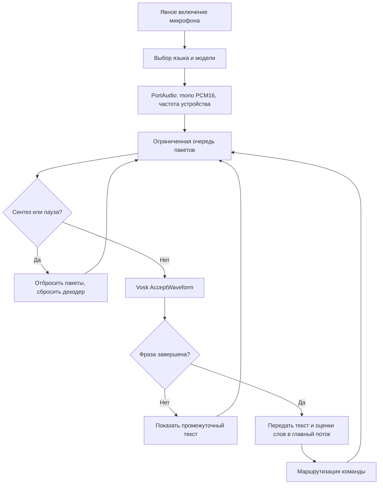
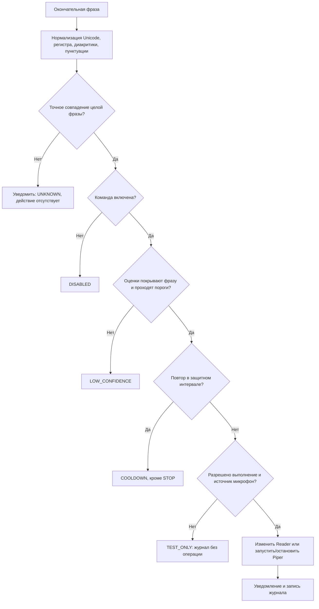

# Отчёт: лабораторная №9, вариант 8

## Задача и соответствие методичке

Автоматизированная система распознавания французской речи для сочинений по литературе.
Реализованы три минимальных требования PDF: пользователь задаёт список операций/фраз; система автоматически реагирует на завершённую речь и уведомляет о решении; язык ASR настраивается.
Для показа выбора ЕЯ дополнительно подключён English. Содержание варианта и синтез остаются французскими.
Система предназначена для Windows; публичная нейросетевая библиотека разрешена методичкой.

## Структура и технологии

| Слой | Ответственность |
|---|---|
| domain | Команды, политика уверенности, маршрутизация, состояние абзацев/темпа, WER |
| application | Контракт Recognizer и сценарий обработки PCM с раздельными замерами инициализации/декодирования |
| infrastructure | Vosk, sounddevice, загрузка WAV/ресэмплинг, JSON-настройки, экспорт журналов |
| presentation | Tkinter, CLI, уведомления, связь команд с Reader/Piper |
| tools | Загрузка моделей с происхождением/хешами, синтетический корпус и отчёты |

Vosk 0.3.45: локальные модели `vosk-model-small-fr-0.22` и `vosk-model-small-en-us-0.15`.
Свободное распознавание используется без ограничивающей грамматики, чтобы произвольная речь не принуждалась к ближайшей команде.
sounddevice/PortAudio предоставляет поток mono PCM16; SoundFile читает WAV; NumPy/SciPy преобразуют первый канал в 16 кГц через полифазный ресэмплинг.
Piper, два французских голоса, SpeechService и WindowsPlayer повторно используются из №8.
TaskRunner из №2 запускает две независимые фоновые задачи ASR и TTS. Tk меняется только главным потоком.
Зависимости зафиксированы в requirements-lock.txt; готовые модели загружаются лениво и повторно используются.

Загрузка Vosk выполняется отдельным инструментом по HTTPS с системным хранилищем truststore.
Сохранены URL, названия моделей, лицензии, SHA-256 архива и файлов в provenance.json.
Проверяется выход путей ZIP за каталог назначения. Хеши описывают скачанную локальную версию, а не независимую подпись издателя.
Рабочие сценарии распознавания не обращаются к сети.

## Алгоритмы

Команды содержат 2–12 слов с префиксом lecteur/reader; нормализованные дубли запрещены.
Среднее арифметическое оценок слов ≥0.75, минимум слова ≥0.55 при исходном пороге.
Оценки Vosk не считаются вероятностью достоверности. Проверяется наличие оценок для всего распознанного текста.
Интервал между одинаковыми действиями — 1.2 с; STOP принимается без этого ограничения.
В живом режиме используется монотонное время, в WAV — время последнего слова.
WAV никогда не выполняет операции. При остановке микрофона завершающий partial не принудительно превращается в команду.
Поколение сеанса в очереди GUI исключает запоздалые события после остановки.
Отмена синтеза не допускает последующего автоматического воспроизведения отменённого результата.

Микрофон по умолчанию приостанавливается на время подготовки и чтения; при возобновлении сбрасывается накопленное состояние распознавателя.
В режиме наушников можно слушать во время WAV-воспроизведения, но вход во время синтеза остаётся приостановленным.
Это управление полудуплексным/дуплексным режимом, а не алгоритм акустического эхоподавления.
Переход выбирает абзац; READ/REPEAT озвучивает его; темп меняется на 0.1× в пределах 0.5–2×.
Синтез занимает отдельный поток; в это время доступны остановка и уведомление о занятости.

## Тестирование

Дата: 2026-10-25, Windows, Python 3.12.6. Исходники проверок — tests/.

- 25 unittest: нормализация, точное сопоставление, partial, язык, отключение, средний/минимальный пороги, неполные оценки слов, повтор и STOP, WER, границы навигации/темпа, конфигурации, аудио, экспорт, отмена, имитация входного потока.
- В составе этих тестов реальные модели Vosk: французская команда STOP, предложение с командой как началом более длинной фразы, английская модель на тишине.
- Отдельный GUI smoke: скрытый Tk, редактор/сохранение настроек, смена языка, устаревшее событие, распознавание WAV без выполнения, реальный Piper, режим паузы/наушников, остановка, отмена. Физический вход и воспроизведение заменены имитацией.
- Ruff check/format и mypy для 21 production/tool файла. Тесты исключены из mypy, но проходят lint.
- CLI и прямой запуск с --help из корня и каталога lab9.

Синтетический корпус содержит 23 случая: 7 команд × 2 голоса, 3 отрицательных предложения × 2 голоса, литературное сочинение, тишину и воспроизводимый шум (seed 98).
Параметры Piper: скорость 1, громкость 0.8; исходные частоты 22050/44100 Гц.
Эталон, гипотеза, ожидаемые/принятые действия, причины отказов, SHA-256 аудио и времена сохранены в ../reports/demo/metrics.json.
Отчёт с аудиоплеерами: ../reports/demo/index.html. Никто не произносил эти записи в микрофон.

| Показатель | Результат |
|---|---|
| Команда принята как ожидаемая операция | 7/14 = 50% |
| Siwis / Tom | 2/7 / 5/7 |
| Ложные активации на отрицательных примерах | 0/9 |
| Нормализованный WER по текстовым примерам | 7/128 = 5.46875% |
| Человеческая речь/реальный микрофон | Не оценены |

WER = (замены + удаления + вставки) / число эталонных слов, расстояние Левенштейна.
Токенизация WER совпадает с нормализацией команд: регистр, диакритика и пунктуация исключены.
Это **нормализованный**, а не строгий орфографический WER; апострофы разделяют слова. Тишина и шум не входят в знаменатель.
Точность команд требует ровно одного ожидаемого действия; отсутствие действия или лишнее действие считается ошибкой.
0/9 — наблюдение на малой выборке, не гарантия отсутствия ложных срабатываний.
Времена в JSON разделяют инициализацию и файловое декодирование. Это не задержка реакции от окончания живой речи; её нужно измерить отдельно.

## Анализ и улучшения

Низкий WER всего корпуса скрывает слабое распознавание коротких команд: длинные литературные предложения увеличивают знаменатель.
Четыре команды совпали по тексту, но были отклонены из-за средней оценки ниже порога; три Siwis-команды распознаны неверно:
«lecteur stop» → «lecteur staps», «lecteur suivant» → «l’été suivant», «lecteur répète» → «l'etat répète».
Итого 11/14 команд совпали по нормализованному тексту, но только 7/14 приняты.
Параметры и фразы не подгонялись под эти ошибки; все отказы видны в исходных данных.

Дальнейшая проверка: записать по несколько повторов команд разными людьми, включая акцент, обычную речь, тишину и шум, разделить подбор порога и независимый тест.
Затем выбрать порог по ошибкам пропуска/ложной активации и показать зависимость от микрофона/шума.
Можно сравнить более крупную французскую модель, естественные альтернативные фразы и отдельный детектор обращения.
Подмена ошибок распознавания искусственными алиасами по единственной записи не подтверждает улучшения на новой речи.
Для динамиков нужен AEC либо сохранение режима паузы. Для прерывания синтеза — потоковый синтез/воспроизведение и явное управление задержкой.
Английская модель технически загружена и выбрана, но качество английских команд на речи отдельно не измерялось.
Человеческая разборчивость голосов и физический принтер также не проверялись.

## Источники и лицензии

- [Официальный каталог Vosk](https://alphacephei.com/vosk/models): обе небольшие модели, версии и Apache-2.0.
- [Официальный пример микрофона Vosk](https://github.com/alphacep/vosk-api/blob/master/python/example/test_microphone.py): RawInputStream и частота устройства.
- Голоса/лицензии Piper и тексты учебных сочинений: документация ../../lab8/README.md и сохранённые MODEL_CARD/manifest.json в lab8/models/.
Piper GPL-3.0; сохранённые карточки голосов: Siwis CC BY 4.0, Tom AGPLv3. Общая лицензия репозитория моделей не заменяет карточку конкретного голоса.
